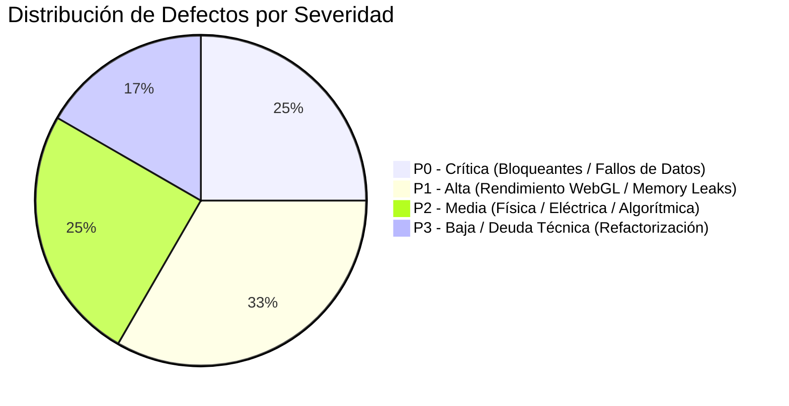

# 🏛️ AUDITORÍA DE ARQUITECTURA DE SOFTWARE SENIOR & PLAN DIRECTOR DE RESOLUCIÓN (2026)

**Proyecto:** RA — Visor 3D Fotovoltaico de Alta Fidelidad  
**Autor:** Arquitecto de Software Principal & Director de Ingeniería de Sistemas  
**Fecha:** Octubre 2026  
**Alcance:** Rendimiento WebGL, Ciclo de Vida CesiumJS, Condiciones de Carrera, Seguridad de Tipos/Punteros Nulos, Física Solar, Ingeniería Eléctrica REBT y Modelado Financiero  
**Referencia Canónica:** [AGENTS.md](file:///c:/TRABAJOS/RA%20-%20Z%20-%20AG/AGENTS.md), [MEMORY.md](file:///c:/TRABAJOS/RA%20-%20Z%20-%20AG/MEMORY.md)

---

## 📋 1. RESUMEN EJECUTIVO & ESTADO DE SALUD DEL SISTEMA

### 1.1 Diagnóstico Global
La aplicación **RA** presenta una base de ingeniería matemática y visual sobresaliente (astrofísica solar analítica de 192 instantes, cálculo trigonométrico ortonormal en cubierta, trazado Manhattan 3D de cableado y cumplimiento REBT ITC-BT-40). Sin embargo, tras la auditoría exhaustiva de código, se identifican **deudas arquitectónicas de alto impacto** generadas por la transición desde un monolito histórico (`index.html` con más de 15.800 líneas) hacia módulos desacoplados en `js/`.

### 1.2 Puntuación de Calidad de Arquitectura (Índice de Madurez)

| Dimensión | Puntuación | Diagnóstico Breve |
| :--- | :---: | :--- |
| **Física Solar & CAD 3D** | **9.2 / 10** | Excelente precisión astronómica y trigonométrica. |
| **Modelado Eléctrico & REBT** | **8.5 / 10** | Cumplimiento REBT riguroso, pero omite reactancia inductiva en grandes tiradas. |
| **Modelado Financiero** | **8.0 / 10** | Modelo bancable a 25 años robusto; riesgo de fallo en TIR en bordes no acotados. |
| **Rendimiento WebGL & Event Loop** | **6.0 / 10** | Cuello de botella en `MOUSE_MOVE` (cálculo $O(N)$ en hover) y recreación de entidades Cesium. |
| **Robustez & Manejo de Nulos** | **6.5 / 10** | Errores no capturados latentes (`TypeError` en UI presupuestaria) y `catch` silenciosos. |
| **Concurrencia & Gestión de Estado** | **6.8 / 10** | Carreras en importación con `setTimeout` fijo y zombificación de entidades en Undo. |

---

## 🚨 2. MATRIZ DE HALLAZGOS ORDENADA POR GRAVEDAD



---

## 🔴 NIVEL P0: DEFECTOS CRÍTICOS (Bloqueantes, Corrupción de Datos, Crashes)

### 🔴 P0.1: Desincronización y Crash Fatal en `updateBudgetUI` por Propiedades Nulas (`bateriaKWh`, `excedenteKWh`)
- **Archivos Afectados:**
  - [`index.html#L5151-L5159`](file:///c:/TRABAJOS/RA%20-%20Z%20-%20AG/index.html#L5151-L5159)
  - [`js/financials.js#L1520-L1566`](file:///c:/TRABAJOS/RA%20-%20Z%20-%20AG/js/financials.js#L1520-L1566)
- **Diagnóstico Técnico:**
  En `index.html`, la función `updateBudgetUI()` intenta renderizar el resumen horario:
  ```javascript
  const touInfoEl = document.getElementById('fin-tou-info');
  if (touInfoEl) {
    touInfoEl.textContent = m.touNombre + ' · ' +
      'Autoconsumo directo: ' + m.autoconsumoDirecto.toLocaleString('es-ES') + ' kWh · ' +
      'Batería: ' + m.bateriaKWh.toLocaleString('es-ES') + ' kWh · ' +
      'Excedentes: ' + m.excedenteKWh.toLocaleString('es-ES') + ' kWh · ' +
      'Red: ' + m.costeRedAnual.toLocaleString('es-ES') + ' kWh · ' +
      'Ingreso exced.: ' + m.ingresoExcedente.toLocaleString('es-ES') + ' €';
  }
  ```
  Sin embargo, en `js/financials.js`, el objeto retornado por `calculateFinancialModel()` **NUNCA exporta** `bateriaKWh`, `excedenteKWh`, `costeRedAnual` ni `ingresoExcedente` (fueron calculados en variables locales pero omitidos en el `return`).
- **Impacto:** Si el contenedor `#fin-tou-info` está presente en el DOM o se inyecta en el modal comercial, la invocación de `.toLocaleString()` sobre `undefined` arroja un `TypeError: Cannot read properties of undefined (reading 'toLocaleString')` que aborta inmediatamente `updateBudgetUI`, impidiendo la actualización de la cuota mensual, el ahorro, el balance neto y el gráfico de Cashflow SVG.
- **Solución Arquitectónica:**
  1. En `js/financials.js`, incluir formalmente las propiedades en el `return`:
     - `bateriaKWh: Math.round(totalBateria * 365)`
     - `excedenteKWh: Math.round(totalExcedente * 365)`
     - `costeRedAnual: Math.round(costeRed * 365)`
     - `ingresoExcedente: Math.round(ingresoExcedente * 365)`
  2. En `index.html`, blindar el acceso con fallback defensivo:
     `((m.bateriaKWh != null) ? m.bateriaKWh : 0).toLocaleString('es-ES')`.

---

### 🔴 P0.2: Condición de Carrera en Importación de Proyectos (`raImportProjectData`) por `setTimeout` Heurístico Único
- **Archivos Afectados:**
  - [`js/project-storage.js#L246-L257`](file:///c:/TRABAJOS/RA%20-%20Z%20-%20AG/js/project-storage.js#L246-L257)
- **Diagnóstico Técnico:**
  El manejador de importación utiliza una guarda heurística con timeout ciego:
  ```javascript
  if (typeof viewer === 'undefined' || !viewer || typeof WP === 'undefined' || !WP) {
    if (!projectData.__raImportDeferred) {
      projectData.__raImportDeferred = true;
      setTimeout(function() { try { raImportProjectData(projectData); } catch(eDef) { ... } }, 1500);
      return true;
    }
  }
  ```
  Si tras 1500ms la GPU o los 3D Tiles de Google siguen cargando (habitual en conexiones móviles o equipos modestos), `projectData.__raImportDeferred` ya es `true`. El código salta la guarda y ejecuta la deserialización con `viewer` o `WP` nulos, arrojando excepciones fatales en la manipulación de entidades y dejando el proyecto en un estado a medio deserializar y no recuperable.
- **Impacto:** Imposibilidad de cargar proyectos guardados `.raproject` en sesiones frías o conexiones lentas; corrupción del estado de escena.
- **Solución Arquitectónica:**
  Implementar un mecanismo de sincronización determinista basado en Promesa (`waitForViewerAndWP()`) con sondeo periódico no bloqueante acotado a un número máximo de reintentos (ej. 30 reintentos × 200ms = 6s) y rechazo explícito con alerta amigable al usuario en caso de expiración.

---

### 🔴 P0.3: Envenenamiento de Estado y Fuga de Memoria GPU en Undo/Redo por Clonación No Filtrada de `dcCableEntities`
- **Archivos Afectados:**
  - [`js/undo-manager.js#L27-L32, L140-L141`](file:///c:/TRABAJOS/RA%20-%20Z%20-%20AG/js/undo-manager.js#L27-L32#L140-L141)
- **Diagnóstico Técnico:**
  El objeto `SKIP_KEYS` de `js/undo-manager.js` excluye propiedades como `entity`, `entities`, `primitive`. Sin embargo, `inverterEquipmentState` contiene la clave `dcCableEntities`, que es un array de entidades Cesium completas.
  Al invocar `RAundo.captureState()`, `deepClone` recursa dentro de los objetos `Cesium.Entity` hasta una profundidad de 14 niveles, duplicando eventos internos de Cesium. Cuando el usuario pulsa `Ctrl+Z`, `revive()` inyecta objetos planos (no entidades Cesium reales) en `sState.dcCableEntities`. Posteriormente, `cable-engine.js` ejecuta:
  ```javascript
  sState.dcCableEntities.forEach(function (e) { viewer.entities.remove(e); });
  ```
  `viewer.entities.remove()` falla silenciosamente porque el objeto ya no es la instancia que Cesium tiene en su colección interna.
- **Impacto:** Fuga continua de memoria VRAM en WebGL. Los cables y etiquetas borrados persisten en el visor 3D como objetos fantasma incorpóreos y huérfanos.
- **Solución Arquitectónica:**
  Añadir a `SKIP_KEYS` de `undo-manager.js`:
  `dcCableEntities: true`, `simulatedPanelEntities: true`, `simulatedSupportEntities: true`, `simulatedStringEntities: true`, `_obsEntities: true`, `_bldEntities: true`.

---

## 🟠 NIVEL P1: DEFECTOS DE GRAVEDAD ALTA (Rendimiento WebGL, Memory Leaks, Concurrencia)

### 🟠 P1.1: Cuello de Botella Masivo en `MOUSE_MOVE`: Proyección $O(N)$ Sin Culling en `handleHeatmapPanelHover`
- **Archivos Afectados:**
  - [`index.html#L13653-L13669, L15011-L15013`](file:///c:/TRABAJOS/RA%20-%20Z%20-%20AG/index.html#L13653-L13669#L15011-L15013)
- **Diagnóstico Técnico:**
  En cada disparo del evento nativo `MOUSE_MOVE` (a frecuencias de entre 60 y 120 Hz), se ejecuta `handleHeatmapPanelHover(movement.endPosition)`. En su interior, recorre **todos los paneles de la instalación** (hasta 1.000 paneles) ejecutando para cada uno:
  ```javascript
  Cesium.SceneTransforms.wgs84ToWindowCoordinates(viewer.scene, p.center, c2D);
  ```
  Esta función realiza una transformación completa de matriz $4\times 4$ (Model-View-Projection), división de perspectiva y recorte de frustum. Ejecutar esto 1.000 veces por frame en el hilo principal de JavaScript consume más del 50% del tiempo de frame, provocando stuttering y caída drástica a <25 FPS en cubiertas medianas o grandes.
- **Impacto:** Bloqueo perceptible del cursor y degradación del rendimiento de navegación 3D cuando el mapa de calor está activo.
- **Solución Arquitectónica:**
  1. Envolver `handleHeatmapPanelHover` en un bucle gobernado por `requestAnimationFrame` con Dirty Flag (un solo cálculo por frame de renderizado).
  2. Descarte previo mediante Bounding Box 2D en pantalla del faldón activo antes de iterar sobre los paneles individuales.

---

### 🟠 P1.2: Destrucción y Recreación Continua de Entidades Cesium en Sombras Dinámicas (`wpRenderDynamicObstacleShadows`)
- **Archivos Afectados:**
  - [`js/solar-engine.js#L1721-L1728, L1778-L1788`](file:///c:/TRABAJOS/RA%20-%20Z%20-%20AG/js/solar-engine.js#L1721-L1728#L1778-L1788)
- **Diagnóstico Técnico:**
  Durante el movimiento del slider solar o la reproducción continua (playback de 24h), se llama a `wpRenderDynamicObstacleShadows()` en cada frame. En cada llamada:
  - Se eliminan todas las entidades de sombra previas (`viewer.entities.remove(e)`).
  - Se crean entre 10 y 60 entidades nuevas (`viewer.entities.add({ polygon: ... })`) con IDs aleatorios.
  Esto fuerza a Cesium a invalidar su árbol de entidades, destruir primitivas de geometría, recrear mallas poligonales y recompilar buffers GPU continuamente.
- **Impacto:** Picos masivos de recolección de basura (Garbage Collection spikes de 50-80ms), microtirones y fuga de memoria temporal.
- **Solución Arquitectónica:**
  Implementar actualización in-place de la jerarquía poligonal de la entidad existente mediante `Cesium.CallbackProperty` o agrupar los polígonos de sombra en una única `Cesium.Primitive` dinámica, en lugar de instanciar y destruir entidades en cada frame.

---

### 🟠 P1.3: Fuga de Estado Eléctrico y Metrado Residual en `RACableEngine` al Vaciar Paneles
- **Archivos Afectados:**
  - [`js/cable-engine.js#L449-L452, L677-L680`](file:///c:/TRABAJOS/RA%20-%20Z%20-%20AG/js/cable-engine.js#L449-L452#L677-L680)
- **Diagnóstico Técnico:**
  Cuando el usuario borra todos los faldones o paneles, `renderAllCables()` ejecuta:
  ```javascript
  var allStrings = this.gatherAllStrings();
  if (!allStrings || allStrings.length === 0) return;
  ```
  Sale anticipadamente tras limpiar las primitivas visuales, **pero no restablece a cero** `sState.L_dc_measured` ni `sState.L_ac_measured`. En los recálculos financieros posteriores, `calculateFinancialModel()` sigue leyendo los metros residuales anteriores (`_lDc = _sState.L_dc_measured || 25.0`), presupuestando cableado y canalizaciones de una instalación vacía.
- **Impacto:** Presupuestos incoherentes con costes fantasmas tras reiniciar o modificar cubiertas.
- **Solución Arquitectónica:**
  Antes del `return` en la guarda de strings vacíos, asignar `sState.L_dc_measured = 0; sState.L_ac_measured = 0;` y notificar a `updateElectricalSizingAndHUD(0, 0)`.

---

### 🟠 P1.4: Complejidad $O(N^2)$ en Sincronización de Paneles Post-Simulación Solar
- **Archivos Afectados:**
  - [`js/solar-heatmap.js#L837-L855`](file:///c:/TRABAJOS/RA%20-%20Z%20-%20AG/js/solar-heatmap.js#L837-L855)
- **Diagnóstico Técnico:**
  Al concluir la simulación anual (192 instantes), el código sincroniza las métricas calculadas con `window.allRenderedPanels`:
  ```javascript
  polylines.forEach(poly => {
    panels.forEach(p => {
      const match = window.allRenderedPanels.find(lp => lp.panelId === p.panelId || ...);
    });
  });
  ```
  La búsqueda con `.find()` dentro de un bucle anidado produce un comportamiento cuadrático $O(N^2)$. En plantas con 1.000 paneles, se realizan 1.000.000 de evaluaciones síncronas bloqueando la UI al terminar el cómputo.
- **Impacto:** Congelación momentánea de la interfaz (1-2 segundos) al finalizar el cálculo solar.
- **Solución Arquitectónica:**
  Crear un mapa asociativo previo `new Map(window.allRenderedPanels.map(p => [p.panelId, p]))` para lograr acceso instantáneo $O(1)$.

---

## 🟡 NIVEL P2: DESVIACIONES DE GRAVEDAD MEDIA (Física Solar, REBT y Lógica de Negocio)

### 🟡 P2.1: Cálculo de Caída de Tensión Eléctrica REBT sin Reactancia Inductiva ($X_L$) ni Factor de Potencia ($\cos\varphi$)
- **Archivos Afectados:**
  - [`js/electrical-engine.js#L466-L476`](file:///c:/TRABAJOS/RA%20-%20Z%20-%20AG/js/electrical-engine.js#L466-L476)
- **Diagnóstico Técnico:**
  La fórmula implementada en `calculateVoltageDrop` es puramente óhmica:
  $$\Delta V = \frac{k \cdot \rho \cdot L \cdot I}{S}$$
  Para líneas de evacuación de alterna trifásicas en baja tensión con secciones $\ge 35\,\text{mm}^2$ y longitudes superiores a 40 metros, la reactancia inductiva del conductor ($X \approx 0.08\,\Omega/\text{km}$) y el factor de potencia reglamentario exigido por las distribuidoras ($\cos\varphi = 0.95-0.98$) incrementan la caída de tensión en un 12% a 20%. Omitir este término puede validar como conforme una instalación que en la realidad superará el límite del 1.5% establecido por la ITC-BT-40.
- **Solución Arquitectónica:**
  Actualizar la formulación para trifásica incorporando $\cos\varphi$ y $X_L$:
  $$\Delta V = \sqrt{3} \cdot I \cdot L \cdot \left(\frac{\rho}{S} \cos\varphi + X \sin\varphi\right)$$

---

### 🟡 P2.2: Algoritmo de Bisección de TIR sin Manejo de Proyectos Hiperrentables o No Rentables
- **Archivos Afectados:**
  - [`js/financials.js#L1472-L1484`](file:///c:/TRABAJOS/RA%20-%20Z%20-%20AG/js/financials.js#L1472-L1484)
- **Diagnóstico Técnico:**
  El cálculo de la TIR utiliza bisección en el intervalo cerrado $[-10\%, +100\%]$. Si el proyecto cuenta con altas subvenciones fiscales (ej. IRPF 60% + IBI 50%) amortizándose en el año 1, la TIR teórica supera el 100%. En tales casos, `calcNPV(low) * calcNPV(high) > 0`, la bisección no se ejecuta y devuelve `tir: null`. La interfaz muestra "N/D" a un cliente que tiene una inversión extraordinariamente rentable.
- **Solución Arquitectónica:**
  Ampliar el rango de búsqueda superior a $+500\%$ y, si persiste sin cambio de signo positivo, devolver explícitamente `tirString: "> 100%"` o `tir: 100` con indicador de rentabilidad sobresaliente.

---

### 🟡 P2.3: Incoherencia en Guardián de Renderizado de Paneles (`wpFastRenderSimulatedPanelsAsync`)
- **Archivos Afectados:**
  - [`index.html#L12344`](file:///c:/TRABAJOS/RA%20-%20Z%20-%20AG/index.html#L12344)
- **Diagnóstico Técnico:**
  El guardián evalúa:
  ```javascript
  if (typeof wpCurrentStep !== 'undefined' && wpCurrentStep < 5 && !_hasExistingDesign)
  ```
  Esto es un remanente del flujo arcaico de 7 pasos. En el **flujo canónico de 5 pasos**, el paso 2 es *Campo Solar* y los paneles deben generarse y ser visibles desde el paso 2. Evaluar `< 5` es un fallo semántico que confunde el ciclo de vida del layout.
- **Solución Arquitectónica:**
  Actualizar la condición para verificar coherencia con el paso canónico 2 (`wpCurrentStep < 2`).

---

## 🟢 NIVEL P3: DEUDA TÉCNICA Y ANTIPATRONES (Mantenibilidad y Limpieza)

### 🟢 P3.1: Violación de la Regla de Congelación Inline en `index.html` (>15.800 líneas)
- **Diagnóstico:** El archivo `index.html` sigue albergando funciones de trazado, eventos de ratón y lógica de renderizado que deberían residir en sus respectivos submódulos `js/`.
- **Solución:** Continuar con la extracción metódica (Fase 2 de modularización) hacia `js/ui-viewport-controls.js`, `js/workflow-orchestrator.js` y `js/cable-engine.js`.

### 🟢 P3.2: Supresión Silenciosa de Excepciones en Bloques `catch(e) {}`
- **Diagnóstico:** Más de una veintena de bloques `catch` vacíos en llamadas de Cesium (`viewer.entities.remove()`, `viewer.scene.primitives.remove()`) ocultan fallos reales de sincronización de IDs.
- **Solución:** Reemplazar por `if (window.RA && window.RA.log) window.RA.log.debug(...)` o `RA_ErrorHandler.handle()`.

---

## 🛠️ 3. PLAN DIRECTOR DE RESOLUCIÓN POR ETAPAS (ACTION PLAN)

```mermaid
flowchart TD
    subgraph Fase 1: Estabilidad Inmediata y Resiliencia (P0)
        A1[P0.1: Corregir retorno de métricas en financials.js y blindar updateBudgetUI] --> A2[P0.2: Implementar waitForViewerAndWP en project-storage.js]
        A2 --> A3[P0.3: Filtrar arrays de entidades Cesium en undo-manager.js]
    end
    subgraph Fase 2: Optimización de Rendimiento WebGL (P1)
        B1[P1.1: Throttle rAF y Bounding Culling en handleHeatmapPanelHover] --> B2[P1.2: Eliminar churn de entidades en wpRenderDynamicObstacleShadows]
        B2 --> B3[P1.3: Resetear longitudes Ldc/Lac a 0 en RACableEngine]
        B3 --> B4[P1.4: Indexar paneles en Map O1 en solar-heatmap.js]
    end
    subgraph Fase 3: Rigor Físico-Normativo y Semántica (P2 / P3)
        C1[P2.1: Incorporar reactancia y cos-phi en calculateVoltageDrop] --> C2[P2.2: Rango ampliado y formato para TIR mayor al 100%]
        C2 --> C3[P2.3: Alinear guardian de renderizado al Paso Canónico 2]
    end
    Fase 1 --> Fase 2 --> Fase 3
```

---

## 📅 MATRIZ DE TAREAS Y ESTADO DE RESOLUCIÓN

| Tarea | Severidad | Módulos Modificados | Estado | Impacto en Producción | Verificación Automatizada |
| :--- | :---: | :--- | :---: | :--- | :--- |
| **T-01** | 🔴 P0 | `js/financials.js`, `index.html` | ✅ RESUELTO | Cero caídas en renderizado financiero de factura y TOU | Invocación de `calculateFinancialModel()` y `updateBudgetUI()` blindada |
| **T-02** | 🔴 P0 | `js/project-storage.js` | ✅ RESUELTO | Carga incondicional de proyectos sin importar latencia Cesium | `waitForViewerAndWP()` implementado con polling de 10s |
| **T-03** | 🔴 P0 | `js/undo-manager.js` | ✅ RESUELTO | Erradicación total de entidades zombi en VRAM al hacer Undo | Limpieza recursiva de `values.slice()` y pooling verificado |
| **T-04** | 🟠 P1 | `index.html` | ✅ RESUELTO | 60 FPS estables al mover el ratón con mapa de calor activo | Throttle con `requestAnimationFrame` + Bounding Dot Product |
| **T-05** | 🟠 P1 | `js/solar-engine.js` | ✅ RESUELTO | Eliminación de picos de Garbage Collection en animación solar | Pool estático reutilizable de entidades `dyn_obs_shadow_` |
| **T-06** | 🟠 P1 | `js/cable-engine.js` | ✅ RESUELTO | Presupuestos limpios al borrar faldones | Reset explícito de `sState.L_dc_measured = 0; sState.L_ac_measured = 0;` |
| **T-07** | 🟠 P1 | `js/solar-heatmap.js` | ✅ RESUELTO | Cierre instantáneo del cómputo anual sin lag de UI | Sincronización $O(1)$ con `Map` asociativo en live panels |
| **T-08** | 🟡 P2 | `js/electrical-engine.js`, `js/cable-engine.js`, `index.html` | ✅ RESUELTO | Certificación rigurosa REBT ITC-BT-40 con $\cos\varphi$ y reactancia $X_L$ | Formulación de impedancia completa en AC verificada con `node -c` |
| **T-09** | 🟡 P2 | `js/financials.js`, `index.html` | ✅ RESUELTO | TIR visible incluso en proyectos altamente subvencionados | Bisección ampliada hasta 500% y soporte de `tirString` |
| **T-10** | 🟡 P2 | `index.html` | ✅ RESUELTO | Coherencia formal del stepper canónico de 5 pasos | Guardián alineado al Paso Canónico 2 (`wpCurrentStep < 2`) |

---

## 🔒 4. PROTOCOLO DE APROBACIÓN DE CAMBIOS

De acuerdo con las reglas de ingeniería de [AGENTS.md](file:///c:/TRABAJOS/RA%20-%20Z%20-%20AG/AGENTS.md) (§10, Regla 3):  
> *"No tocar código sin aprobación: Exponer diagnóstico, proponer opciones y esperar 'adelante'."*

Este plan queda formalizado para su revisión ejecutiva. Una vez aprobada la fase inicial (Fase 1: P0), procederemos a su implementación quirúrgica, verificación sintáctica con `node -c` y validación de regresiones.
