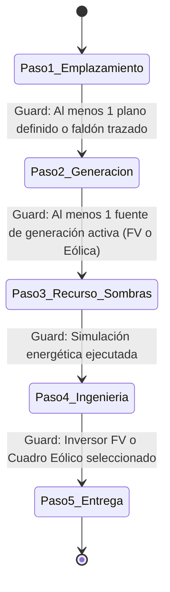

# 🌪️ ESPECIFICACIÓN TÉCNICA DE ARQUITECTURA DE SOFTWARE: MÓDULO EÓLICO E HÍBRIDO (RA-WIND)
**Estándar de Calidad AAA · Arquitectura Desacoplada · Simulación Concurrente a 60 FPS · Garantía Zero-Regression**  
*Documento Canónico de Ingeniería de Software para Implementación Paso a Paso*  
*Versión: 1.1-AAA Production Ready (Corregida tras Auditoría de Integración)*  
*Fecha: Octubre 2026*  
*Autor: Dirección de Ingeniería de Software, Dinámica Estructural y Aerodinámica Eólica RA*

---

## 📑 ÍNDICE GENERAL

1. [Visión y Principios Arquitectónicos AAA](#1-visión-y-principios-arquitectónicos-aaa)
2. [Estructura Modular, Árbol de Ficheros y Patrón de Módulos Universal](#2-estructura-modular-árbol-de-ficheros-y-patrón-de-módulos-universal)
3. [Contratos de Interfaces, Esquemas de Datos y Migración Legada](#3-contratos-de-interfaces-esquemas-de-datos-y-migración-legada)
4. [Integración en la Máquina de Estados Finita (Workflow Orchestrator FSM)](#4-integración-en-la-máquina-de-estados-finita-workflow-orchestrator-fsm)
5. [Pipeline Gráfico 3D, Gizmos y Preservación de 60 FPS en CesiumJS](#5-pipeline-gráfico-3d-gizmos-y-preservación-de-60-fps-en-cesiumjs)
6. [Motor Numérico Concurrente (Web Worker & Transferables)](#6-motor-numérico-concurrente-web-worker--transferables)
7. [Algoritmos Físico-Matemáticos Paso a Paso](#7-algoritmos-físico-matemáticos-paso-a-paso)
8. [Ingeniería Eléctrica, REBT y Generación de Esquemas Unifilares](#8-ingeniería-eléctrica-rebt-y-generación-de-esquemas-unifilares)
9. [Gemelo Digital Operativo (SCADA & WebSockets - Fase 4)](#9-gemelo-digital-operativo-scada--websockets---fase-4)
10. [Plan de Pruebas Automatizadas y Presupuesto de Rendimiento](#10-plan-de-pruebas-automatizadas-y-presupuesto-de-rendimiento)
11. [Protocolo de Integración No Destructiva (Zero-Regression) y Hoja de Ruta](#11-protocolo-de-integración-no-destructiva-zero-regression-y-hoja-de-ruta)

---

## 1. VISIÓN Y PRINCIPIOS ARQUITECTÓNICOS AAA

El subsistema eólico de **RA** (`RA-Wind`) amplía el visor solar fotovoltaico 3D convirtiéndolo en una **estación de trabajo de hibridación eólico-solar de alta fidelidad**. Su diseño satisface rigurosamente los siguientes principios de arquitectura de software:

* **Compatibilidad Absoluta y Regresión Cero (Zero-Regression):** Ningún cálculo, flujo, guard o exportación fotovoltaica existente en RA se ve alterado. Los proyectos 100% solares siguen funcionando de forma idéntica. El módulo eólico se añade de forma modular y aditiva.
* **Patrón de Empaquetado Universal (UMD/IIFE):** Todo el código cliente se distribuye encapsulado en cierres inmediatos (IIFE) compatibles con el ámbito global (`window` / `globalThis`), permitiendo su ejecución directa en el navegador sin herramientas de empaquetado obligatorias y superando sin excepciones el linter sintáctico de Node.js (`tests/test-js-syntax.js` con `node -c`).
* **Desacoplamiento Estricto (Loose Coupling):** La lógica de cálculo aerodinámico, acústico y eléctrico reside en servicios aislados sin dependencias del DOM ni de CesiumJS. Los motores pueden ejecutarse en Node.js para testing unitario o en Web Workers para cálculo en navegador.
* **Tasa de Refresco Garantizada a 60 FPS (Zero-Jank UI):** Todo cálculo intensivo (simulación anual 8760 h, integración de Weibull, propagación de estelas y mapas acústicos) se descarga a un `Worker` dedicado (`wind-worker.js`) mediante transferibles (`ArrayBuffer`).
* **Zero-Recreation en Render Loop:** Durante la manipulación interactiva de aerogeneradores con Gizmos 3D (arrastre y rotación), las matrices de modelo (`modelMatrix`) de Cesium se actualizan in-place en la GPU sin destruir ni re-instanciar geometrías ni shaders. Los cálculos pesados de texturas de terreno (isófonas acústicas) se difieren al evento `dragEnd` (onRelease).
* **Inmutabilidad, Event-Driven State y Política de Estado Sucio:** Las mutaciones de estado se notifican a través del bus de eventos central (`RAEventBus`). Cualquier modificación física de un aerogenerador invalida de forma explícita la caché de despacho 8760h y acústica, marcando los resultados como "pendientes de recalcular".

---

## 2. ESTRUCTURA MODULAR, ÁRBOL DE FICHEROS Y PATRÓN DE MÓDULOS UNIVERSAL

### 2.1. Árbol de Ficheros del Subsistema Eólico

El subsistema eólico se organiza bajo el directorio `js/wind/` con responsabilidades unívocas:

```
c:/TRABAJOS/RA/RA/
├── js/
│   ├── wind/
│   │   ├── wind-constants.js          # Constantes físicas, normativas y coeficientes por defecto
│   │   ├── wind-catalog.js            # Base de datos de aerogeneradores (HAWT y VAWT)
│   │   ├── wind-entity.js             # Objeto de dominio y nodo del Scene Graph (WindTurbineInstance)
│   │   ├── wind-visualizer.js         # Primitivas CesiumJS, batching WebGL y animación cinemática
│   │   ├── wind-resource.js           # Parsers de viento (Weibull, ERA5/GWA API y archivos horarios)
│   │   ├── wind-rooftop-cfd.js        # Modelo analítico de capa límite, burbuja de cubierta y speed-up
│   │   ├── wind-acoustics.js          # Modelo de propagación acústica ISO 9613-2 y texturizado 3D
│   │   ├── wind-shadow-flicker.js     # Trazado astronómico de sombras intermitentes a receptores
│   │   ├── wind-structural.js         # Comprobación de cargas CTE DB-SE-AE y resonancia 1P/3P
│   │   ├── wind-electrical.js         # Rectificador, freno reostático, protecciones REBT y cableado
│   │   ├── wind-hybrid-dispatch.js    # Despacho 8760h conjunto FV-Eólica, peak-shaving y BESS
│   │   ├── wind-telemetry.js          # Conector IoT/WebSocket para el Gemelo Digital (Fase 4)
│   │   ├── wind-ui.js                 # Controladores de interfaz de usuario, paneles HUD y herramientas
│   │   └── wind-worker.js             # Web Worker dedicado a cálculo pesado no bloqueante
│   ├── workflow-orchestrator.js       # Integración de estados y guards ampliados
│   ├── project-hierarchy.js           # Soporte de nodos de aerogenerador en el Scene Graph
│   ├── project-storage.js             # Serialización y deserialización aditiva en .raproject
│   └── docs-generator.js              # Generación de la Memoria Técnica Híbrida y Unifilar IEC
```

### 2.2. Patrón Estándar de Encapsulación UMD/IIFE

Para garantizar la compatibilidad con el entorno de pruebas `node -c` y la arquitectura cliente de RA, todos los módulos de `js/wind/` implementan la siguiente plantilla canónica:

```javascript
(function (global) {
  'use strict';

  // Espacio de nombres unificado
  const RAWind = global.RAWind || (global.RAWind = {});

  // Lógica interna desacoplada
  const RooftopCFD = {
    evaluateRooftopAerodynamics: function (H, W, L, xSetback, zElevation) {
      // Cálculo puramente numérico...
    }
  };

  // Exportación segura para Navegador (window), Web Worker (self) o Node.js (global/exports)
  RAWind.RooftopCFD = RooftopCFD;
  if (typeof module !== 'undefined' && module.exports) {
    module.exports = RooftopCFD;
  }
})(typeof window !== 'undefined' ? window : (typeof self !== 'undefined' ? self : global));
```

---

## 3. CONTRATOS DE INTERFACES, ESQUEMAS DE DATOS Y MIGRACIÓN LEGADA

### 3.1. Definición de Aerogenerador en Catálogo (`WindTurbineCatalogItem`)

```typescript
interface WindTurbineCatalogItem {
  id: string;                          // Identificador único (ej. "bornay-wind-25.3")
  manufacturer: string;                // Fabricante (ej. "Bornay Aerogeneradores")
  model: string;                       // Modelo comercial
  type: 'HAWT' | 'VAWT';               // Eje horizontal o vertical
  ratedPowerW: number;                 // Potencia nominal eléctrica (W)
  rotorDiameterM: number;              // Diámetro del rotor (m)
  sweptAreaM2: number;                 // Área de barrido (m²)
  bladeCount: number;                  // Número de palas (ej. 3)
  hubHeightsAvailableM: number[];      // Alturas de torre certificadas [12, 18, 24, 30]
  cutInSpeedMs: number;                // Velocidad de arranque (m/s)
  ratedSpeedMs: number;                // Velocidad nominal (m/s)
  cutOutSpeedMs: number;               // Velocidad de corte por tempestad (m/s)
  survivalSpeedMs: number;             // Velocidad extrema de supervivencia Ve50 (m/s)
  iecClass: 'I' | 'II' | 'III' | 'IV' | 'S'; // Clase IEC 61400-2
  acousticPowerLwaDba: number;         // Nivel de potencia sonora garantizado LwA en dB(A)
  octaveBandSpectrumDb: {              // Espectro por bandas de octava [63 Hz - 8 kHz]
    63: number; 125: number; 250: number; 500: number;
    1000: number; 2000: number; 4000: number; 8000: number;
  };
  powerCurve: Array<{ v: number; p: number; ct: number }>; // Curvas P(v) y Ct(v) a rho=1.225
  electrical: {
    generatorType: 'PMSG' | 'IG' | 'DFIG'; // Generador de imanes permanentes, inducción, etc.
    outputVoltageV: number;            // Tensión nominal trifásica AC (V)
    rectifierIncluded: boolean;        // ¿Incorpora rectificador en góndola?
    dumpLoadRequiredKw: number;        // Potencia de resistencia de frenado reostático
  };
  structural: {
    nacelleMassKg: number;             // Masa de góndola + rotor en punta de torre
    rotorMassKg: number;               // Masa exclusiva del conjunto del rotor
    maxThrustKn: number;               // Empuje aerodinámico extremo en eje del buje
    naturalFrequencyHz: number;        // Frecuencia propia de la torre
  };
}
```

### 3.2. Instancia de Aerogenerador en Escena (`WindTurbineInstance`)

```typescript
interface WindTurbineInstance {
  id: string;                          // GUID de la instancia (ej. "wt_8f3a9c21")
  catalogId: string;                   // Referencia a WindTurbineCatalogItem
  name: string;                        // Nombre legible (ej. "Aerogenerador Nave Norte 1")
  positionCartographic: {              // Coordenadas geográficas WGS84
    longitudeRad: number;
    latitudeRad: number;
    altitudeM: number;
  };
  mountingType: 'ground' | 'rooftop';  // Cimentación en suelo o anclaje a cubierta
  supportStructure: {
    type: 'tubular' | 'lattice' | 'guyed' | 'hydraulic_tilting';
    hubHeightM: number;
    baseFoundationId?: string;         // Referencia a zapata o bancada
  };
  orientationRad: number;              // Ángulo actual de guiñada (yaw) respecto al Norte
  operationalState: {
    enabled: boolean;
    curtailmentRulesActive: boolean;
    liveTelemetryConnected: boolean;
  };
  simulationResults?: {
    aepNetKwh: number;
    capacityFactor: number;
    wakeLossPercentage: number;
    rooftopSpeedupGainPercentage: number;
    isDirty: boolean;                  // Flag de invalidación de caché
  };
}
```

### 3.3. Protocolo de Migración de Obstáculos Legados (`legacyObstacleMigration`)

En versiones anteriores de RA, los aerogeneradores se creaban en `obstacles[]` con tipo `wind_turbine`. Para garantizar la compatibilidad:
1. Al cargar un `.raproject`, si `obstacles` contiene un objeto con `type === 'wind_turbine'`, el motor de persistencia ejecuta una bifurcación no destructiva:
   - Si no existe `projectData.windTurbines`, se crea automáticamente una instancia `WindTurbineInstance` en `global.windTurbines` mapeando las propiedades legadas (`mastHeight`, `bladeRadius`).
   - El obstáculo legado se mantiene en modo sombra o se retira del cálculo fotovoltaico para evitar duplicidad de geometrías.

---

## 4. INTEGRACIÓN EN LA MÁQUINA DE ESTADOS FINITA (WORKFLOW ORCHESTRATOR FSM)

La máquina de estados finita (`WorkflowOrchestrator`) gobierna el progreso del proyecto en los 5 pasos canónicos obligatorios definidos en `AGENTS.md`.



### 4.1. Modificación de Guards en `canEnterStep` (Zero-Regression)

En `workflow-orchestrator.js`, la validación de prerrequisitos se amplía de manera aditiva:

```javascript
// Método helper aditivo en WorkflowOrchestrator
hasActiveGenerationSource() {
  const hasPanels = this.hasGeneratedPanels();
  const hasWind = Array.isArray(global.windTurbines) && global.windTurbines.some(t => t && t.operationalState && t.operationalState.enabled !== false);
  return hasPanels || hasWind;
}

// Actualización en canEnterStep(step):
if (step === 3 || step === 4) {
  if (!this.hasActiveGenerationSource()) {
    return {
      allowed: false,
      reason: 'Requiere definir al menos una fuente de generación (paneles solares o aerogeneradores) en el Paso 2'
    };
  }
} else if (step === 5) {
  if (!this.hasActiveGenerationSource()) {
    return { allowed: false, reason: 'Requiere completar el diseño de generación en los pasos anteriores' };
  }
  const hasInverter = this.hasConfiguredInverter();
  const hasWindEquipment = Array.isArray(global.windTurbines) && global.windTurbines.length > 0;
  if (!hasInverter && !hasWindEquipment) {
    return {
      allowed: false,
      reason: 'Requiere seleccionar el equipamiento de conversión (inversor solar o cuadro eólico) en el Paso 4'
    };
  }
}
```

### 4.2. Política Reactiva de Estado Sucio e Invalidación de Caché (Dirty State)

Para mantener la integridad de los resultados cuando el usuario reconfigura la escena:
* Cualquier mutación física de un aerogenerador (cambio de posición, altura de mástil o modelo) emite el evento `RAEventBus.emit('wind_turbines_changed', { turbineId })`.
* El suscriptor marca `turbine.simulationResults.isDirty = true`.
* Los paneles del Paso 3 (Análisis) y Paso 5 (Entrega) muestran un indicador visual: `⚠️ Resultados desactualizados por cambio de emplazamiento. Haga clic para recalcular`.
* Se evita así que el usuario genere ofertas comerciales con simulaciones no sincronizadas con la escena 3D.

---

## 5. PIPELINE GRÁFICO 3D, GIZMOS Y PRESERVACIÓN DE 60 FPS EN CESIUMJS

### 5.1. Renderizado por Instancia y Actualización en Caliente (In-Place `modelMatrix`)

Para cumplir el presupuesto de 60 FPS estables:
1. **Consolidación en Primitiva Única:** Cada aerogenerador se renderiza mediante una `Cesium.Primitive` consolidada (Fuste + Góndola + Rotor) minimizando las *draw calls*.
2. **Manipulación en Tiempo Real (Gizmo Drag):** Durante el evento `MOUSE_MOVE` del Gizmo 3D, **únicamente se muta la matriz `modelMatrix` de la primitiva existente en la GPU**. Queda terminantemente prohibido destruir o reinstanciar primitivas o shaders durante el arrastre.

### 5.2. Desacoplamiento del Mapa Acústico (Diferimiento a `dragEnd`)

* **Riesgo:** Generar texturas de isófonas de 100x100 en un `Canvas2D` offscreen y subirlas como `Cesium.GroundPrimitive` en cada frame colapsa el ancho de banda PCIe y reduce los fotogramas a <20 FPS.
* **Solución Arquitectónica:**
  * Durante el arrastre (`MOUSE_MOVE`): Se proyecta un círculo vectorial ligero de coste cero en GPU que representa el radio de seguridad de caída ($1.1 \times H_{\text{punta}}$) y el contorno de 50 dB(A) aproximado.
  * Al soltar el cursor (`MOUSE_UP` / `dragEnd`): Se dispara la solicitud al `wind-worker.js` para generar la matriz acústica precisa ISO 9613-2 y se actualiza la textura sobre el terreno en una única pasada asíncrona.

---

## 6. MOTOR NUMÉRICO CONCURRENTE (WEB WORKER & TRANSFERABLES)

Todo el procesamiento que requiera más de $16\,\text{ms}$ se delega al `wind-worker.js`.

### 6.1. Protocolo de Mensajería del Web Worker

```typescript
// Solicitudes a Worker
type WindWorkerRequest = 
  | { type: 'COMPUTE_AEP'; payload: { resource: WindResourceData; turbines: WindTurbineInstance[]; density: number } }
  | { type: 'COMPUTE_ROOFTOP_SPEEDUP'; payload: { buildingGeometry: BuildingBBox; windDirectionDeg: number; approachSpeed: number } }
  | { type: 'COMPUTE_ACOUSTIC_GRID'; payload: { turbines: WindTurbineInstance[]; gridResolutionM: number; bounds: BoundingBox } }
  | { type: 'COMPUTE_SHADOW_FLICKER'; payload: { turbine: WindTurbineInstance; receptors: WindowReceptor[]; year: number } }
  | { type: 'COMPUTE_HYBRID_DISPATCH_8760'; payload: { solarHourlyKwh: Float32Array; windTurbines: WindTurbineInstance[]; consumptionKwh: Float32Array; bessCapacityKwh: number; gridLimitKw: number } };

// Respuestas del Worker
type WindWorkerResponse = 
  | { type: 'AEP_COMPLETE'; result: { totalAepKwh: number; turbineBreakdown: Record<string, number>; wakeLossFactor: number } }
  | { type: 'ROOFTOP_SPEEDUP_COMPLETE'; result: { speedupFactor: number; separationBubbleHeightM: number; optimalSetbackM: number } }
  | { type: 'ACOUSTIC_GRID_COMPLETE'; result: { buffer: ArrayBuffer; width: number; height: number; minDba: number; maxDba: number } }
  | { type: 'SHADOW_FLICKER_COMPLETE'; result: { receptorMinutesPerYear: Record<string, number>; calendar: Array<{ date: string; minutes: number }> } }
  | { type: 'HYBRID_DISPATCH_COMPLETE'; result: { selfConsumptionRate: number; curtailmentKwh: number; peakShavingSavingsEur: number; hourlyProfile: ArrayBuffer } };
```

---

## 7. ALGORITMOS FÍSICO-MATEMÁTICOS PASO A PASO

### 7.1. Algoritmo de Burbuja de Cubierta y Speed-Up (`wind-rooftop-cfd.js`)

Calcula la envolvente de la burbuja de separación y el factor de aceleración sobre una cubierta industrial (Wilson, 1979):

```javascript
(function (global) {
  'use strict';

  const RAWind = global.RAWind || (global.RAWind = {});

  function evaluateRooftopAerodynamics(H, W, L, xSetback, zElevation) {
    // Longitud de escala característica de la estructura
    const Sc = Math.pow(Math.min(H, W), 2/3) * Math.pow(Math.max(H, W), 1/3);
    const Lc = 0.9 * Sc;  // Longitud de la burbuja
    const Hc = 0.22 * Sc; // Altura máxima sobre arista
    
    let bubbleHeightAtX = 0;
    if (xSetback >= 0 && xSetback <= Lc) {
      bubbleHeightAtX = Hc * Math.pow(1 - (xSetback / Lc), 2);
    }
    
    const insideSeparationBubble = zElevation <= bubbleHeightAtX;
    let speedupFactor = 1.0;
    
    if (!insideSeparationBubble) {
      const deltaZ = zElevation - bubbleHeightAtX;
      const decayLength = 0.5 * Hc;
      const maxSpeedupAtEdge = 1.30 * Math.exp(-xSetback / (0.8 * Sc));
      speedupFactor = 1.0 + (maxSpeedupAtEdge - 1.0) * Math.exp(-deltaZ / decayLength);
    } else {
      speedupFactor = 0.35; // Penalización severa por recirculación turbulenta
    }
    
    const addedTurbulenceIntensity = insideSeparationBubble ? 0.45 : (0.12 * (Hc / Math.max(zElevation, 0.1)));

    return {
      insideSeparationBubble,
      bubbleHeightAtX,
      speedupFactor: Math.max(speedupFactor, 0.2),
      addedTurbulenceIntensity,
      isRecommendedMicrositing: !insideSeparationBubble && speedupFactor >= 1.10
    };
  }

  RAWind.evaluateRooftopAerodynamics = evaluateRooftopAerodynamics;
  if (typeof module !== 'undefined' && module.exports) {
    module.exports = { evaluateRooftopAerodynamics };
  }
})(typeof window !== 'undefined' ? window : (typeof self !== 'undefined' ? self : global));
```

### 7.2. Algoritmo de Propagación Acústica ISO 9613-2 (`wind-acoustics.js`)

```javascript
(function (global) {
  'use strict';

  const RAWind = global.RAWind || (global.RAWind = {});

  function calculateOctaveSoundLevel(LwA, distanceM, freqHz, tempC, relHumidity, groundFactor) {
    if (distanceM <= 1.0) return LwA;
    
    // 1. Divergencia esférica
    const A_div = 20 * Math.log10(distanceM) + 11;
    
    // 2. Absorción atmosférica (dB/km)
    const alphaDbPerKm = RAWind.getAtmosphericAbsorption ? RAWind.getAtmosphericAbsorption(freqHz, tempC, relHumidity) : 1.5;
    const A_atm = (alphaDbPerKm * distanceM) / 1000.0;
    
    // 3. Atenuación por suelo duro (asfalto/cubierta industrial G=0)
    const A_gr = -1.5 + (groundFactor * 3.0);
    
    const Lp = LwA - (A_div + A_atm + A_gr);
    return Math.max(Lp, 0);
  }

  RAWind.calculateOctaveSoundLevel = calculateOctaveSoundLevel;
  if (typeof module !== 'undefined' && module.exports) {
    module.exports = { calculateOctaveSoundLevel };
  }
})(typeof window !== 'undefined' ? window : (typeof self !== 'undefined' ? self : global));
```

---

## 8. INGENIERÍA ELÉCTRICA, REBT Y GENERACIÓN DE ESQUEMAS UNIFILARES

### 8.1. Arquitectura de Hibridación Eléctrica
1. **Acoplamiento en AC (Topología Descentralizada):** Inversor FV e Inversor Eólico inyectan en barras paralelas del Cuadro General de Distribución (CGD). La potencia de acometida y el antivertido (RD 244/2019) se calculan mediante balance neto vectorial con Smart Meter.
2. **Acoplamiento en DC:** Rectificación del aerogenerador a bus DC común de almacenamiento BESS o entrada a inversor híbrido multicanal.

### 8.2. Cuadro de Protecciones Eólico Obligatorio (REBT ITC-BT-40 e ITC-BT-23)
* **Resistencia de Frenado (*Dump Load*):** $120\%$ de la potencia nominal durante 30 minutos ininterrumpidos en caso de disparo de protecciones de red.
* **Protección Diferencial:** Clase B (sensible a corrientes continuas alisadas y componentes de alta frecuencia).
* **Sobretensiones Transitorias:** Tipo 1+2 en la base de la torre eólica y Tipo 2 en el inversor.
* **Cálculo de Caída de Tensión:** Límite máximo reglamentario $\le 1.5\%$ entre generador y CGD.

---

## 9. GEMELO DIGITAL OPERATIVO (SCADA & WEBSOCKETS - FASE 4)

> [!NOTE]
> Para garantizar el cumplimiento de plazos y evitar sobre-ingeniería en la herramienta de diseño de ingeniería, la integración del Gemelo Digital en vivo mediante WebSockets se programa como **Fase 4 (Ampliación Post-Construcción)**.

La arquitectura de la Fase 4 consumirá tramas JSON normalizadas:

```typescript
interface WindTurbineLiveTelemetryFrame {
  turbineId: string;
  timestamp: string;               // ISO 8601
  windSpeedMs: number;
  windDirectionDeg: number;
  yawHeadingDeg: number;
  rotorRpm: number;
  generatorTempC: number;
  activePowerW: number;
  dumpLoadActive: boolean;
  alarmCodes: string[];
}
```

---

## 10. PLAN DE PRUEBAS AUTOMATIZADAS Y PRESUPUESTO DE RENDIMIENTO

### 10.1. Matriz de Pruebas Unitarias e Integración (`tests/`)

```
tests/
├── test-wind-rooftop-cfd.js       # Comprobación de burbuja y speed-up frente a datos de túnel de viento
├── test-wind-acoustics.js         # Verificación ISO 9613-2 contra casos de referencia (WindPRO)
├── test-wind-shadow-flicker.js    # Trazado de horas de parpadeo y sombras sobre módulos solares
├── test-wind-hybrid-dispatch.js   # Conservación de la energía horaria en simulación 8760h
└── test-wind-rebt-electrical.js   # Verificación de caída de tensión <= 1.5% y dump load
```

### 10.2. Presupuesto de Rendimiento (Performance Budget AAA)

| Métrica | Límite Máximo Aceptable | Mecanismo de Garantía |
| :--- | :--- | :--- |
| **FPS en Manipulación 3D (Gizmo Drag)** | $\ge 58\,\text{FPS}$ estables | Transformación directa de `modelMatrix` en GPU sin recrear primitivas. |
| **Cálculo de AEP Anual (Weibull 12 sectores)** | $< 45\,\text{ms}$ | Ejecución asíncrona en `wind-worker.js`. |
| **Generación de Malla Acústica ISO 9613-2** | $< 120\,\text{ms}$ para $100 \times 100$ puntos | Vectorización matemática con `Float32Array`. Cálculo aplazado a `dragEnd`. |
| **Simulación Híbrida 8760 h (Despacho Horario)** | $< 250\,\text{ms}$ por año completo | Algoritmo lineal $O(N)$ en Web Worker. |
| **Memoria Heap Adicional** | $< 35\,\text{MB}$ | Reutilización de buffers transferibles y cero recolección de basura en render loop. |

---

## 11. PROTOCOLO DE INTEGRACIÓN NO DESTRUCTIVA (ZERO-REGRESSION) Y HOJA DE RUTA

Para implementar el sistema de forma controlada y blindar la operatividad de RA, la ejecución se estructura en las siguientes fases secuenciales:

### 11.1. Hoja de Ruta de Implementación por Fases

| Fase | Alcance y Módulos | Criterio de Aceptación |
| :--- | :--- | :--- |
| **Fase 1: Dominio, Catálogo, 3D y Persistencia** | `wind-constants.js`, `wind-catalog.js`, `wind-entity.js`, `wind-visualizer.js`, `project-storage.js`, `workflow-orchestrator.js`. | • Inserción de aerogenerador en suelo o cubierta.<br>• Gizmo 3D a $\ge 58$ FPS.<br>• Guardado y recarga en `.raproject` sin alterar proyectos solares.<br>• `npm test` pasa al 100%. |
| **Fase 2: Motor Numérico Concurrente e Ingeniería** | `wind-worker.js`, `wind-resource.js`, `wind-rooftop-cfd.js`, `wind-acoustics.js`, `wind-structural.js`, `wind-electrical.js`. | • Cálculo de speed-up en cubierta industrial.<br>• Malla acústica ISO 9613-2 generada en worker.<br>• Dimensionado de dump load, protecciones REBT y cableado.<br>• Tests unitarios de física eólicos superados. |
| **Fase 3: Despacho Híbrido, Documentación y Oferta** | `wind-hybrid-dispatch.js`, `wind-shadow-flicker.js`, `wind-ui.js`, `docs-generator.js`, `financials.js`. | • Simulación 8760h combinada con curva de factura horaria.<br>• Sombras parpadeantes sobre paneles solares.<br>• Exportación de Memoria Técnica Híbrida oficial y Esquema Unifilar IEC. |
| **Fase 4: Telemetría SCADA y Shaders Avanzados** | `wind-telemetry.js`, Shaders GPU Viewshed ZVI. | • Conexión WebSocket con analizadores IoT.<br>• Alertas predictivas Teórico vs. Real en operación. |

### 11.2. Protocolo de Verificación Continua (CI / Regression Gate)
Antes de fusionar cada fase:
1. Ejecutar `cd RA; npm test` para validar que los 42 módulos preexistentes y los nuevos pasan el test sintáctico y de flujo sin regresiones.
2. Cargar un proyecto solar existente guardado en `.raproject` y comprobar que faldones, inversores, strings y memorias PDF se generan de forma idéntica al estado previo.
3. Crear un proyecto híbrido y validar que la suma de potencias y protecciones en el cuadro general respeta las tablas del REBT.

---
*Fin de la Especificación de Arquitectura de Software v1.1-AAA. El documento queda consolidado como especificación técnica canónica y lista para su implementación por fases.*