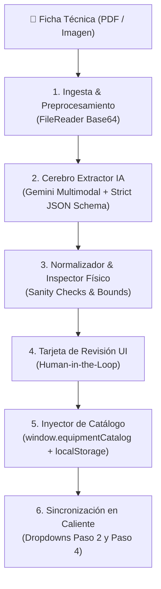

# 📑 PLAN DE IMPLEMENTACIÓN: IMPORTADOR INTELIGENTE DE FICHAS TÉCNICAS (DATASHEETS) CON IA

> **Versión:** 1.0.0  
> **Estado:** En Implementación  
> **Fecha:** Octubre 2026  
> **Arquitectura:** Módulo Autónomo Desacoplado (`js/equipment-ai-importer.js`)  
> **Compatibilidad:** Google Gemini Multimodal API (v1beta / Gemini 2.5 & 2.0 Flash)

---

## 1. 🎯 Objetivos y Alcance

### 1.1 El Problema Actual
La introducción manual de equipos fotovoltaicos en el catálogo técnico de la aplicación es lenta y susceptible a errores humanos críticos:
- Las fichas técnicas de fabricantes (JA Solar, Longi, Huawei, Fronius, BYD, Enphase, etc.) constan de tablas densas con decenas de columnas y notas al pie.
- Un error de transcripción en la tensión en circuito abierto ($V_{\text{oc}}$), en el coeficiente de temperatura ($\%/^\circ\text{C}$) o en las dimensiones ($L \times W$) invalida los cálculos de seguridad eléctrica (IEC 62548, REBT ITC-BT-40) y el empaquetamiento 3D en cubierta.

### 1.2 La Solución
Crear un **subsistema modular independiente y escalable** (`RAEquipmentAIImporter`) que:
1. Permita **arrastrar y soltar (Drag & Drop)** o seleccionar cualquier PDF o imagen de ficha técnica de equipos solares.
2. Utilice **IA Multimodal (Google Gemini)** con esquemas JSON estructurados estrictos para clasificar y extraer todos los parámetros electrotécnicos y mecánicos.
3. Aplique un **motor de validación y coherencia física** antes de incorporar los datos (detección de incoherencias, conversiones de unidades y normalización).
4. Presente una **tarjeta de revisión interactiva (Human-in-the-Loop)** para que el instalador confirme y guarde el equipo en el catálogo persistente (`window.equipmentCatalog` / `localStorage`).
5. Se sincronice **en caliente** con los selectores del Paso 2 (Campo Solar) y Paso 4 (Ingeniería Eléctrica) sin requerir recarga de página.

---

## 2. 🏗️ Arquitectura del Sistema



### 2.1 Principios de Diseño
- **Single Responsibility:** El módulo `js/equipment-ai-importer.js` se encarga exclusivamente del ciclo de vida de la importación (lectura, inferencia, validación, UI de revisión).
- **Desacoplamiento Gráfico:** No depende de CesiumJS ni de estados del visor 3D.
- **Tolerancia a Fallos:** Si la IA no detecta algún campo opcional (como el precio o la degradación anual), el motor aplica valores técnicos de ingeniería seguros por defecto.
- **Seguridad de Claves:** Reutiliza de forma centralizada la API Key configurada en `localStorage('ra_gemini_api_key')` o `window.RA.geminiApiKey`.

---

## 3. 📊 Esquemas de Datos por Tipología de Equipo

### 3.1 Módulo Fotovoltaico (`module`)
```json
{
  "category": "modules",
  "brand": "string",
  "model": "string",
  "wp": "number (Wp, e.g. 450)",
  "eff": "number (%, e.g. 21.5)",
  "l": "number (longitud en metros, e.g. 1.76)",
  "w": "number (anchura en metros, e.g. 1.13)",
  "th": "number (grosor en metros, e.g. 0.030)",
  "voc": "number (V, tensión circuito abierto)",
  "isc": "number (A, corriente cortocircuito)",
  "vmp": "number (V, tensión máxima potencia)",
  "imp": "number (A, corriente máxima potencia)",
  "tempCoeffPmax": "number (%/°C, e.g. -0.34)",
  "tempCoeffVoc": "number (%/°C, e.g. -0.26)",
  "cellType": "TOPCon | HJT | PERC | Monocristalino",
  "bifacial": "boolean",
  "bifacialityFactor": "number (0.70 - 0.85)",
  "price": "number (€, editable)"
}
```

### 3.2 Inversor de Red / Híbrido (`inverter`)
```json
{
  "category": "inverters",
  "brand": "string",
  "model": "string",
  "kw": "number (potencia nominal AC en kW, e.g. 5.0)",
  "type": "Monofásico | Trifásico | Híbrido",
  "mppt": "number (número de seguidores MPPT, e.g. 2)",
  "inputsPerMppt": "number (entradas por MPPT, e.g. 1 o 2)",
  "vMpptMin": "number (V, e.g. 90)",
  "vMpptMax": "number (V, e.g. 560)",
  "vDcMax": "number (V máx absoluta, e.g. 600 o 1000)",
  "vStart": "number (V arranque, e.g. 100)",
  "iMaxOperA": "number (A máx por MPPT, e.g. 13.5)",
  "iMaxScA": "number (A máx cortocircuito por MPPT, e.g. 18.0)",
  "effMax": "number (%, e.g. 98.4)",
  "price": "number (€, editable)"
}
```

### 3.3 Batería de Almacenamiento (`battery`)
```json
{
  "category": "batteries",
  "brand": "string",
  "model": "string",
  "kwh": "number (capacidad útil neta en kWh, e.g. 10.0)",
  "kwhNominal": "number (capacidad total bruta en kWh, e.g. 10.24)",
  "type": "LFP Alto Voltaje | LFP Bajo Voltaje | Modular",
  "vNom": "number (V nominal, e.g. 400)",
  "kwMax": "number (potencia máx carga/descarga en kW, e.g. 5.0)",
  "dod": "number (profundidad de descarga %, e.g. 95)",
  "cycles": "number (ciclos de vida garantizados, e.g. 6000)",
  "price": "number (€, editable)"
}
```

### 3.4 Microinversores y Optimizadores (`microinverter`)
```json
{
  "category": "microinverters",
  "brand": "string",
  "model": "string",
  "kw": "number (potencia nominal AC en kW, e.g. 0.800)",
  "type": "Microinversor 1-en-1 | Microinversor 2-en-1 | Optimizador DC",
  "mppt": "number",
  "vMpptMin": "number",
  "vMpptMax": "number",
  "price": "number (€, editable)"
}
```

---

## 4. 🔬 Reglas del Inspector Físico y Coherencia (Sanity Checks)

Antes de aceptar los datos extraídos por la IA, el motor aplica reglas de seguridad física:

1. **Leyes Eléctricas Fundamentales:**
   - Para módulos: $V_{\text{oc}} > V_{\text{mp}}$ y $I_{\text{sc}} > I_{\text{mp}}$. Si no se cumple, se rechaza o invierte el error de lectura.
   - La potencia nominal $P_{\text{mp}}$ debe ser aproximadamente $V_{\text{mp}} \times I_{\text{mp}}$ (tolerancia $\pm 5\%$). Si hay discrepancia, se recalcula $P_{\text{mp}}$.
2. **Dimensiones Físicas Reales:**
   - Longitud de panel $L \in [1.20, 2.60]$ metros.
   - Anchura de panel $W \in [0.80, 1.40]$ metros.
   - Grosor $T_h \in [0.025, 0.045]$ metros (25 a 45 mm). Si la IA extrae 30, se convierte automáticamente a $0.030$ m.
3. **Rangos de Inversores:**
   - $V_{\text{dc,max}} \ge V_{\text{mppt,max}} > V_{\text{mppt,min}} > 0$.
   - Tensión de arranque $V_{\text{start}} \in [V_{\text{mppt,min}}, V_{\text{mppt,max}}]$.
4. **Precios por Defecto:**
   - Si la ficha no incluye coste comercial (habitual en datasheets técnicos), se asigna un precio de mercado de referencia:
     - Módulo: $0.22\ \text{€/Wp}$ (aprox. 90-120 €).
     - Inversor: $150\ \text{€/kW}$ (aprox. 750-1.500 €).
     - Batería: $400\ \text{€/kWh}$ (aprox. 3.000-5.000 €).

---

## 5. 🚀 Plan de Implementación por Fases

| Fase | Tarea | Entregable |
| :---: | :--- | :--- |
| **Fase 1** | **Motor Extractor IA (`js/equipment-ai-importer.js`)** | Ingesta de archivos, llamadas a API Gemini con prompts de ingeniería estructurada y normalización. |
| **Fase 2** | **Inspector de Coherencia Electrotécnica** | Batería de comprobaciones matemáticas y conversiones de unidades. |
| **Fase 3** | **Interfaz de Usuario y Zona Drag & Drop** | Pestaña `✨ IMPORTAR PDF CON IA` en el modal de catálogo, pantalla de carga y tarjeta de confirmación. |
| **Fase 4** | **Sincronización en Caliente y Pruebas Unitarias** | Actualización reactiva de dropdowns y suite de tests automatizada (`scratch/test_equipment_ai_importer.js`). |

---

## 6. 🛡️ Resiliencia y Manejo de Errores

> [!IMPORTANT]
> **API Key Ausente:** Si el usuario no ha configurado la API Key de Gemini en la aplicación, el importador no se bloquea; muestra un diálogo amigable con enlace directo a la configuración de empresa para introducirla con un clic.

> [!NOTE]
> **Documentos Multipágina o Complejos:** Las fichas técnicas a menudo presentan 4 o 5 potencias del mismo modelo (ej. serie 430W, 435W, 440W, 445W, 450W). El prompt instruye a la IA a priorizar el modelo de mayor potencia de la serie o permitir seleccionar la variante.
