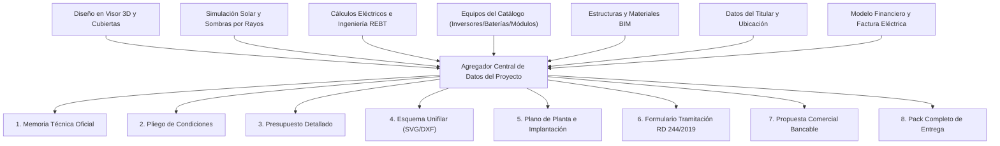

# Auditoría Integral de la Suite de Documentación Técnica de RA

Esta auditoría evalúa exhaustivamente el nivel de alineación de los **8 documentos técnicos y comerciales** generados por la aplicación frente a la **Fuente Única de Verdad (SSOT)** del proyecto.

---

## 1. Mapa de Fuentes de Verdad (SSOT) del Proyecto

Para que un documento técnico sea 100% veraz e inalterable, debe nutrirse de forma directa y sincronizada de los 7 pilares de datos del diseño:

---

## 2. Diagnóstico Documento a Documento

### 📄 Doc 1: Memoria Técnica Oficial (REBT / ITC-BT-40 / UNE-EN 62446)
*Estado: ALINEACIÓN ALTA (90%) — Requiere enriquecimiento de equipos y almacenamiento.*

* **Alineación con la SSOT:**
  * **Datos del promotor y ubicación:** Toma directamente el titular, NIF, CUPS, distribuidora, dirección completa, coordenadas geográficas y potencia contratada.
  * **Geometría y módulos:** Si el proyecto cuenta con múltiples cubiertas y modelos de paneles, incorpora de forma nativa la tabla multi-modelo y el desglose de subcampos por cubierta.
  * **Simulación solar:** Si se ha calculado el mapa de calor anual, las 12 barras de producción mensual y el total anual se sustituyen por el valor real calculado con pérdidas por sombreado tridimensional.
  * **Ingeniería eléctrica:** Incorpora la telemetría individual de cada string con su longitud real medida en 3D, caída de tensión calculada y verificación reglamentaria ($\le 1,5\%$).
  * **Finanzas:** Integra la tabla de flujos de caja a 25 años, VAN, TIR, LCOE y el gráfico de amortización.
* **Puntos de desconexión detectados:**
  * **Ficha del Inversor genérica:** Mientras que los paneles solares cuentan con una ficha técnica completa, el inversor se describe con un texto genérico de potencia sin reflejar la marca comercial, modelo exacto, número de MPPTs ni rango de tensiones seleccionados en el catálogo.
  * **Tensión máxima fija:** Se comprueba la tensión de string contra un límite genérico de 1.000 V en lugar de leer el valor `v_max_dc` específico del inversor elegido.
  * **Omisión de Baterías:** Si el usuario configura un sistema de almacenamiento con batería en el proyecto, la memoria técnica no incluye su descripción técnica, capacidad útil ni esquema de conexión.
  * **Topología de microinversores:** Si se seleccionan microinversores, la memoria sigue describiendo una arquitectura de inversor de string central con cajas de agrupación de continua.

---

### 📄 Doc 2: Pliego de Condiciones Técnicas
*Estado: ALINEACIÓN MEDIA (75%) — Estructura normativa sólida, parametrización mejorable.*

* **Alineación con la SSOT:**
  * Vinculado con la potencia pico del proyecto, el titular, la distribuidora asignada, la tensión calculada en frío y la resistencia de puesta a tierra reglamentaria.
  * Incluye los protocolos de ensayo e inspección conforme a la norma UNE-EN 62446 y los plazos de garantía legales.
* **Puntos de desconexión detectados:**
  * **Pliego genérico:** Redacta condiciones mínimas para cualquier equipo en lugar de particularizar las condiciones para la marca y modelo exactos seleccionados en el catálogo.
  * **Sin apartado de almacenamiento:** No dispone de cláusulas específicas de seguridad y normativa para baterías de litio (UNE-EN IEC 62619, ventilación, distancias de seguridad contra incendios).
  * **Multi-modelo:** En proyectos con más de un modelo de panel, solo toma como referencia la potencia del módulo principal.

---

### 📄 Doc 3: Presupuesto Detallado de Ejecución
*Estado: ALINEACIÓN EXCELENTE (96%) — El documento más conectado a la ingeniería 3D.*

* **Alineación con la SSOT:**
  * **Medición real 3D de cableado:** Lee las coordenadas tridimensionales del trazado para calcular los metros reales de cable solar ZZ-F y de evacuación AC, indicando expresamente si se trata de una medición 3D real o una estimación paramétrica.
  * **Estructuras según Árbol de Materiales:** El coste y tipología de estructura soporte (coplanar vs lastrada) se calcula de forma automática según la inclinación y el desglose de materiales.
  * **Desglose multi-modelo y por cubierta:** Si hay diferentes modelos o faldones, los desglosa en unidades de obra separadas con su coste unitario real.
  * **Capítulo de Almacenamiento y Optimizadores:** Incorpora de forma dinámica los capítulos de batería y optimizadores a nivel de módulo cuando están seleccionados en el proyecto.
  * **Retorno bancable:** Totalmente coordinado con el modelo financiero a 25 años y con los incentivos fiscales municipales (IBI, ICIO, IRPF).
* **Puntos de desconexión detectados:**
  * La descripción del inversor en el Capítulo 3 aún utiliza una plantilla paramétrica en lugar del nombre comercial exacto del catálogo.

---

### 📄 Doc 4: Esquema Unifilar Normalizado (SVG y DXF AutoCAD)
*Estado: ALINEACIÓN ALTA (85%) — Excelente rigor gráfico IEC 60617, topología rígida.*

* **Alineación con la SSOT:**
  * Cartela oficial ISO 7200 con todos los datos del promotor, técnico, número de colegiado, CUPS y referencia.
  * Tabla lateral de ingeniería con potencias, secciones de cable, protecciones (fusibles gPV, IGA, diferencial clase A, protectores de sobretensión DC y AC) y caída de tensión.
  * Representación proporcional de los strings de paneles con sus parámetros eléctricos reales (Voc en frío a -10 °C, Isc, Imp).
* **Puntos de desconexión detectados:**
  * **Falta de Batería en el diagrama:** Aunque el presupuesto y la propuesta comercial incorporen la batería, el esquema unifilar no dibuja el acumulador, el seccionador de batería ni su línea de conexión al inversor híbrido.
  * **Marca y modelo del inversor:** La caja del inversor solo muestra la potencia nominal y no la referencia comercial del catálogo.
  * **Topología única:** Dibuja siempre una topología de inversor central. No se adapta visualmente si el usuario selecciona una instalación basada en microinversores.

---

### 📄 Doc 5: Plano de Planta e Implantación de Módulos (2D / Canvas)
*Estado: ALINEACIÓN CRÍTICA / INSUFICIENTE (40%) — Requiere refactorización.*

* **Puntos de desconexión detectados:**
  * **Bloqueo en proyectos multi-cubierta:** El generador del plano comprueba una variable de dibujo simple que queda vacía cuando se crean cubiertas con el gestor avanzado de faldones múltiples, provocando un aviso de error erróneo que impide abrir el plano.
  * **Omisión de cubiertas secundarias:** Solo calcula y dibuja la geometría de la primera cubierta, dejando fuera todos los demás faldones diseñados.
  * **Desconexión con los paneles reales situados en 3D:** En lugar de dibujar exactamente los paneles colocados y orientados en el visor tridimensional, recalcula una cuadrícula teórica bidimensional. Si el instalador ha movido o borrado paneles manualmente, esos cambios no se reflejan fielmente en el plano.
  * **Elementos de la instalación ausentes:** No se representa la ubicación en planta del inversor, el cuadro general ni la trayectoria del cableado.

---

### 📄 Doc 6: Formulario Administrativo de Tramitación (RD 244/2019)
*Estado: ALINEACIÓN ALTA (90%) — Muy completo para tramitaciones ante distribuidora y CCAA.*

* **Alineación con la SSOT:**
  * Rellena automáticamente todos los campos del promotor, punto de suministro, potencia contratada, técnico proyectista, modalidad legal de autoconsumo y producción estimada.
  * Incluye la declaración responsable oficial y la lista de control de documentos necesarios.
* **Puntos de desconexión detectados:**
  * Si el proyecto dispone de batería, no se menciona en la sección de datos técnicos, siendo este un dato obligatorio para la inscripción en los registros autonómicos de autoconsumo (RAAC).
  * En configuraciones con varios modelos de paneles, solo resume el modelo principal.

---

### 📄 Doc 7: Propuesta Comercial Bancable (PDF Profesional)
*Estado: ALINEACIÓN EXCELENTE (98%) — El documento comercial más avanzado.*

* **Alineación con la SSOT:**
  * Incorpora la identidad corporativa completa (logotipo, colores, garantías, datos fiscales de la empresa instaladora).
  * Resuelve directamente las marcas y modelos comerciales de inversores, baterías y paneles del catálogo.
  * Gráficos dinámicos integrados: histograma de producción mensual real y curva de amortización acumulada con indicación del año de retorno.
  * Comparativa de gasto mensual con y sin energía solar basada en la auditoría de factura eléctrica real.
  * Desglose analítico de rentabilidad con y sin subvenciones fiscales.

---

### 📄 Doc 8: Pack de Entrega Unificado
*Estado: ALINEACIÓN MEDIA (70%) — Funcional pero con riesgo de bloqueo en el navegador.*

* **Puntos de desconexión detectados:**
  * **Apertura de ventanas múltiples:** En lugar de empaquetar todos los archivos en un único archivo descargable (ZIP) o un documento consolidado, intenta abrir varias pestañas consecutivas en el navegador, lo que activa con frecuencia el bloqueador de ventanas emergentes del cliente.
  * **Faltan documentos en el pack:** No incluye de forma automática la descarga del Esquema Unifilar (SVG/DXF) ni del Plano de Planta.

---

## 3. Matriz Resumen de Cobertura de Datos

| Variable del Proyecto | Memoria Técnica | Pliego | Presupuesto | Esquema Unifilar | Plano Planta | Formulario RD 244 | Propuesta Comercial |
| :--- | :---: | :---: | :---: | :---: | :---: | :---: | :---: |
| **Datos Titular y Ubicación** | ✅ Sí | ✅ Sí | ✅ Sí | ✅ Sí | ✅ Sí | ✅ Sí | ✅ Sí |
| **Paneles totales y kWp reales** | ✅ Sí | ✅ Sí | ✅ Sí | ✅ Sí | ⚠️ Parcial | ✅ Sí | ✅ Sí |
| **Desglose Multi-Cubierta / Multi-Módulo** | ✅ Sí | ⚠️ Solo mod. 1 | ✅ Sí | ⚠️ Solo mod. 1 | ❌ No | ⚠️ Solo mod. 1 | ✅ Sí |
| **Simulación Solar (Raycast / Pérdidas)** | ✅ Sí | ❌ N/A | ✅ Sí | ❌ N/A | ❌ N/A | ✅ Sí | ✅ Sí |
| **Longitud 3D Real de Cables** | ✅ Sí | ❌ N/A | ✅ Sí | ⚠️ Parcial | ❌ No | ❌ N/A | ❌ N/A |
| **Marca y Modelo del Inversor** | ❌ Solo kW | ❌ No | ⚠️ Solo kW | ❌ Solo kW | ❌ No | ❌ Solo kW | ✅ Sí |
| **Sistema de Batería / Almacenamiento** | ❌ Omitido | ❌ No | ✅ Sí | ❌ Omitido | ❌ No | ❌ Omitido | ✅ Sí |
| **Microinversores y Optimizadores** | ⚠️ Genérico | ❌ No | ✅ Sí | ❌ No | ❌ No | ❌ No | ✅ Sí |
| **Modelo Financiero a 25 años** | ✅ Sí | ❌ N/A | ✅ Sí | ❌ N/A | ❌ N/A | ❌ N/A | ✅ Sí |

---

## 4. Plan de Acción Recomendado

Para lograr una coherencia documental del 100% en toda la aplicación, se propone la siguiente hoja de ruta de mejoras:

1. **Sincronización Total de Inversor y Baterías en Memoria Técnica y Esquema Unifilar:**
   * Conectar la marca, modelo, número de MPPTs y límites de tensión del catálogo en la Memoria Técnica.
   * Incorporar la representación del módulo de baterías y sus protecciones en el Esquema Unifilar y en la Memoria cuando estén presentes.
2. **Modernización del Plano de Planta:**
   * Conectar el generador del plano con el gestor de faldones múltiples y con la lista de paneles reales colocados en el visor 3D, permitiendo visualizar todas las cubiertas y la posición del inversor.
3. **Descarga Unificada en ZIP del Pack de Entrega:**
   * Agrupar todos los documentos generados (PDFs, SVG y DXF) en un único archivo comprimido para evitar bloqueos del navegador.
