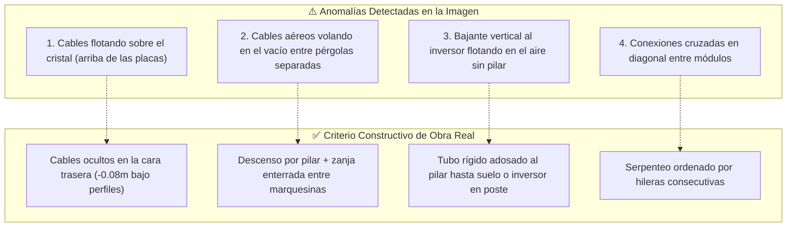

# ⚡ Crítica de Ingeniería: Cableado en Pérgolas y Marquesinas Fotovoltaicas

**Evaluador:** Ingeniero Industrial Colegiado, especialista en Instalaciones Solares Fotovoltaicas y Estructuras Marquesina/Pérgola.

---

## 1. Imagen Analizada y Diagnóstico Visual

La imagen muestra una instalación fotovoltaica sobre tres mesas elevadas tipo **pérgola / marquesina** soportadas por pilares tubulares de acero. 

El resultado visual actual resulta **poco natural y constructivamente irreal** por cuatro causas físicas muy concretas:

---

## 2. Detalle de los 4 Problemas Identificados

### 1. Cables flotando por encima del cristal fotovoltaico
* **El problema en la imagen:** Las líneas azules de conexión entre módulos aparecen dibujadas 12 cm **por encima** de las placas solares, proyectándose en el aire hacia el cielo.
* **La realidad en obra:** Los módulos fotovoltaicos captan luz por su cara superior de vidrio templado. Ningún cable puede pasar jamás por delante de las células (generaría puntos calientes / *hotspots* por sombra permanente). Las cajas de bornes estancas (IP68) y los latiguillos van siempre en el **reverso** (cara inferior), embridados a las guías de aluminio de la subestructura.

---

### 2. Cables volando en el aire entre pérgolas independientes
* **El problema en la imagen:** Se aprecian líneas cian que saltan directamente desde la mesa central a la mesa de la derecha a unos 3-4 metros del suelo, cruzando el aire como si fueran cables de alta tensión tendidos sin postes intermedios.
* **La realidad en obra:** En aparcamientos y pérgolas exteriores, está terminantemente prohibido por seguridad y estética tener cables sueltos volando entre estructuras separadas. El viento los batiría hasta romper los conectores y existe riesgo de enganche con vehículos.
* **Criterio reglamentario (REBT ITC-BT-07 e ITC-BT-20):** 
  - La interconexión entre pérgolas independientes se realiza bajando por el pilar de la primera marquesina en tubo de protección mecánica (IK10), pasando a una **canalización subterránea (zanja)** con tubo corrugado de doble pared (D=63 o 90 mm) enterrado a 0,60 m con cinta de señalización, y subiendo por el pilar de la marquesina contigua.
  - Alternativamente, si existe una viga de celosía o puente metálico de unión superior, los cables viajan alojados en una bandeja perforada con tapa sobre dicha viga.

---

### 3. Bajante vertical al inversor en el vacío
* **El problema en la imagen:** El cable principal (azul/rojo) sale del faldón de la pérgola delantera y, en lugar de apoyarse en alguno de los pilares verticales que sostienen la cubierta, quiebra en el aire y cae a plomo a través del espacio libre hasta llegar al suelo.
* **La realidad en obra:** En cualquier estructura elevada, la bajante de cables siempre aprovecha la propia estructura portante:
  1. Los cables discurren por una bandeja o canaleta metálica fijada a la correa o viga principal trasera de la pérgola.
  2. Llegan al pilar más cercano (normalmente el más próximo al cuadro o punto de conexión).
  3. Descienden verticalmente grapados o embutidos dentro de un tubo rígido fijado al alma del pilar metálico.

---

### 4. Cruce diagonal desordenado entre placas (*Stringing*)
* **El problema en la imagen:** Las conexiones no siguen una secuencia lógica por filas. Hay saltos en tijera que cruzan en diagonal entre módulos de la fila superior y la inferior (`MPPT1:01` saltando sobre `MPPT1:07`), generando un entramado confuso.
* **La realidad en obra:** El conexionado en pérgolas de 2 o 3 filas de módulos se realiza en **serpenteo continuo (*daisy-chain*)** o **salto alterno (*leapfrog*)**, completando primero una hilera recta y pasando de forma limpia a la hilera contigua en el extremo de la mesa.

---

## 3. Plan de Mejoras Propuesto para Pérgolas y Marquesinas

Para que la representación en pérgolas sea fotorealista e impecable desde el punto de vista de ingeniería, se proponen 5 ajustes en el motor de trazado:

| # | Mejora Propuesta | Impacto Visual y de Ingeniería |
| :---: | :--- | :--- |
| **1** | **Cota Negativa (Cables por la Cara Inferior)** | Cambiar el desplazamiento de los latiguillos a $-0.08\text{ m}$ respecto a la normal del plano. Los cables quedan ocultos y limpios bajo las placas, tal como en una pérgola real. |
| **2** | **Bajante Acompañando al Pilar** | Cuando la estructura sea de tipo elevado (pérgola/marquesina), la bajante busca el pilar más próximo y desciende exactamente por su coordenada vertical, evitando caídas libres en el aire. |
| **3** | **Enlace Subterráneo entre Pérgolas Separadas** | Detectar si dos faldones o mesas están desacoplados espacialmente; si pertenecen al mismo circuito, el cable desciende por el pilar de la primera mesa, transcurre a cota de suelo (zanja) y sube por el pilar de la siguiente. |
| **4** | **Inversor Adosado a Pilar (Opción Recomendada)** | En pérgolas, el inversor y el cuadro de protecciones se ubican habitualmente anclados al pilar de la propia estructura a $1,50\text{ m}$ de altura, simplificando la bajada a un tramo directo vertical. |
| **5** | **Ordenación Geométrica de la Hilera** | Ordenar los módulos de cada serie geométricamente según su coordenada longitudinal ($U$) y transversal ($V$), garantizando un serpenteo limpio sin cruces diagonales. |

---

## 4. Conclusión

El comportamiento observado se debe a que el motor actual asumía una cubierta de tejado continuo (donde una elevación positiva despega el cable de la teja). Al tratarse de **pérgolas elevadas sobre pilares**, ese mismo algoritmo hace que los cables floten sobre el cristal y caigan por el aire.

Con invertir la cota a la cara inferior y anclar las bajantes y cruces a los pilares y al suelo, la representación alcanzará un realismo técnico absoluto apto para proyectos ejecutivos y licencias de obra.
