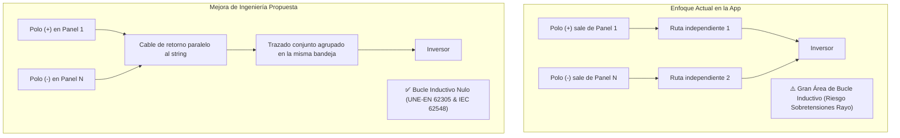

# Crítica Constructiva de Ingeniería Industrial: Tiradas de Cable y Canalizaciones en RA

**Perfil de evaluación:** Ingeniero Industrial Colegiado, especialista en Diseño, Dirección de Obra y Homologación de Centrales Fotovoltaicas (BT / MT).

---

## 1. Diagnóstico del Estado Actual en RA

La implementación actual de las tiradas de cable (*homeruns*) en RA destaca positivamente frente a la mayoría de herramientas de diseño preliminar del mercado, que suelen limitarse a líneas rectas aéreas ficticias. 

### Puntos Fuertes Destacables:
* **Trazado Ortogonal a 90° (Manhattan 3D):** Respeta los ejes geométricos del tejado (eje paralelo a cumbrera y eje de máxima pendiente), evitando cables flotantes y reproduciendo la disposición típica de una bandeja portacables.
* **Geometría Volumétrica con Sombras Reales:** La extrusión tridimensional de tubos y bandejas con proyección de sombras sobre la teja aporta un realismo constructivo superior.
* **Diferenciación de Polos y Tipologías:** Separa físicamente el polo positivo (+), negativo (-), troncales de cajas de conexión y evacuación de alterna.
* **Medición Métrica Real en 3D:** La longitud calculada alimenta la caída de tensión en la Memoria Técnica conforme a la norma **ITC-BT-40** ($\Delta V \le 1,5\%$).

---

## 2. Crítica Constructiva desde la Práctica de Ingeniería de Obra

A pesar de sus sólidas bases geométricas, un instalador electricista habilitado o un director de obra detectará varias discrepancias frente a la realidad de una instalación en cubierta:

### 1. El Bucle de Inducción Electromagnética (UNE-EN 62305 / IEC 62548)
* **El problema físico:** Actualmente, el cable positivo sale del primer panel y el cable negativo sale del último por caminos independientes a través del tejado. Esta separación espacial genera un lazo cerrado de gran superficie.
* **Impacto en obra:** En caso de caída cercana de un rayo, la variación del campo magnético induce sobretensiones destructivas ($V = -d\Phi/dt$) capaces de perforar los diodos bypass de los paneles y quemar los seguidores del inversor.
* **Criterio normativo:** La normativa exige que el conductor de retorno de cada string viaje pegado y paralelo a los módulos y a su polo opuesto, minimizando el área de bucle a cero.

---

### 2. Visibilidad del Cableado Entre Módulos (*Stringing*)
* **El problema físico:** El visor muestra cómo baja el cable principal al inversor, pero no muestra cómo se conectan los paneles entre sí dentro de la misma serie.
* **Impacto en obra:** El instalador no sabe qué placas pertenecen a cada serie ni si la conexión se realiza de forma consecutiva clásica (*daisy-chain*) o mediante salto alterno (*leapfrog* / salto de rana) para evitar cables de retorno extra.

---

### 3. Intersección con Obstáculos en Cubierta
* **El problema físico:** El algoritmo ortogonal realiza quiebros matemáticos directos hacia el inversor. Si en su trayectoria encuentra una chimenea, casetón o claraboya, el cable cruza a través del sólido en lugar de bordearlo por el pasillo de paso.
* **Criterio normativo:** El Código Técnico de la Edificación (**CTE DB-SI**) exige pasillos de evacuación y mantenimiento libres de canalizaciones tropezables.

---

### 4. Dimensionado Real de Canalizaciones (REBT ITC-BT-19 e ITC-BT-20)
* **El problema físico:** La bandeja portacables y los tubos tienen un tamaño gráfico fijo independientemente de si llevan 1 string (2 cables) o 8 strings (16 cables).
* **Criterio reglamentario:** El factor de ocupación de una canalización no debe superar el 40% de su sección útil interior. Al acumular strings, la bandeja debe ensancharse visualmente y en el metrado de materiales (bandeja de 60, 100 o 200 mm).

---

### 5. Omisión del Conductor Equipotencial de Puesta a Tierra
* **El problema físico:** Toda cubierta fotovoltaica metálica requiere un cable de tierra de cobre desnudo (16 o 35 mm²) conectado a la estructura y a los marcos de los módulos que discurre en paralelo a los cables solares.
* **Criterio reglamentario:** La norma **ITC-BT-18** e **ITC-BT-40** exige la continuidad de tierra en todas las masas metálicas exteriores.

---

## 3. Plan de Mejoras Propuesto para RA

Para elevar el motor de cableado al máximo estándar de ingeniería ejecutable, se proponen las siguientes 5 actuaciones:

| # | Mejora Propuesta | Beneficio para el Diseñador e Instalador |
| :---: | :--- | :--- |
| **1** | **Retorno Compensado Anti-Bucle** | Los cables positivo y negativo viajan emparejados por la misma canalización, garantizando el cumplimiento contra rayos (**UNE-EN 62305**). |
| **2** | **Coloración y Conexión de Strings (Stringing)** | Identificar visualmente con un tono suave qué paneles integran cada serie y la ruta de conexión entre ellos (*daisy-chain* o *leapfrog*). |
| **3** | **Esquivado de Obstáculos y Pasillos de Paso** | El cableado bordea chimeneas y claraboyas y se ciñe a los pasillos perimetrales de la cubierta. |
| **4** | **Bandejas y Tubos con Sección Dinámica** | El ancho de la bandeja o diámetro del tubo en fachada crece automáticamente según el número de cables que alberga. |
| **5** | **Desglose en Mediciones de Obra** | Distinguir en el presupuesto los metros de cable solar, metros de tubo de fachada, metros de bandeja metálica y conectores estancos. |
