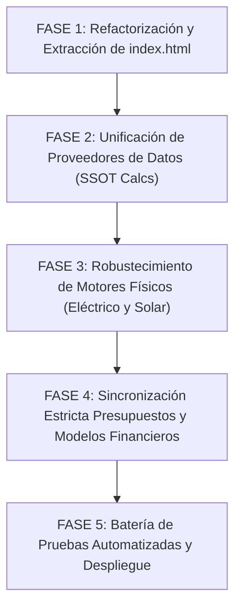

# INFORME DE AUDITORÍA QUIRÚRGICA MULTIDISCIPLINAR (ARQUITECTURA DE SOFTWARE E INGENIERÍA INDUSTRIAL RENOVABLE)

**Proyecto:** RA (Visor 3D Fotovoltaico y Eólico Híbrido)  
**Fecha:** 28 de Octubre de 2026  
**Roles del Auditor:**  
1. Arquitecto de Software Senior & Líder de Plataforma Web 3D.  
2. Ingeniero Industrial Senior, Especialista Colegiado en Energías Renovables (Solar Fotovoltaica, Eólica Distribuida y Almacenamiento).  
**Destinatario:** Equipos de Desarrollo, Agentes de IA Autónomos (Codex, Claude Code, Antigravity) e Ingenieros de Sistemas.  
**Estado del Repositorio:** Rama `feature/nuevas-funciones` (`c:\TRABAJOS\RA\RA`).

---

## 1. RESUMEN EJECUTIVO Y ALCANCE

Se ha realizado una auditoría estricta, profunda y quirúrgica del proyecto **RA**, evaluando tanto la integridad arquitectónica del software (modularidad, cohesión, gestión de estado global, patrones de diseño, rendimiento 3D WebGL/CesiumJS y ciclo de vida de datos) como la veracidad técnica y normativa de los modelos de ingeniería industrial (física solar, aerodinámica de minieólica, electrotecnia bajo REBT/ITC-BT, CTE DB-HE5, cálculo de pérdidas, dimensionamiento de strings/MPPT, despacho horario estacional 288h, baterías LFP bajo IEC 62619 y viabilidad financiera bancable según UNE/NREL/IRENA).

### Veredicto Global:
El proyecto posee una **base técnica y matemática de un nivel de excelencia sobresaliente**, con algoritmos astronómicos y normativos genuinos (Perez 1990, Duffie-Beckman, raycasting 3D con Cesium, REBT ITC-BT-40/19/07, flujo de caja descontado a 25 años con degradación N-Type/TOPCon y perfiles de carga estacionales reales).

No obstante, **el software sufre de una severa deuda técnica por hipertrofia de código inline y fragmentación de estado (`index.html` con más de 16.100 líneas de script, 520 variables contaminando `window`)**, duplicidad de contratos entre módulos (`docs-generator.js`, `financials.js`, `commercial-proposal-dossier.js`) y desacoplamientos puntuales donde ciertas heurísticas o fallbacks legacy amenazan la condición de **Single Source of Truth (SSOT)**.

---

## 2. MATRIZ DE RIESGOS Y CLASIFICACIÓN DE HALLAZGOS

| ID | Área | Naturaleza | Severidad | Impacto |
| :--- | :--- | :--- | :--- | :--- |
| **A-01** | Arquitectura Software | Monolito inline en `index.html` (16.179 líneas de script) | **CRÍTICA (P0)** | Dificulta mantenimiento, testing aislado y control de concurrencia. |
| **A-02** | Arquitectura Software | Polución masiva de `window` (307 propiedades únicas / 520 asignaciones) | **ALTA (P1)** | Colisiones de nombres, variables globales mudables sin control de mutación. |
| **A-03** | Arquitectura / Datos | Triplicación de contratos de proyecto (`getProjectCalcs` vs `_canonicalGetProjectCalcs`) | **ALTA (P1)** | Si el motor canónico no ha cargado, se emiten datos legacy desalineados. |
| **A-04** | Arquitectura / UI | Duplicidad y divergencia en generación de dossiers (`docs-generator` vs `commercial-proposal-dossier` vs `financials`) | **MEDIA (P2)** | Mantenimiento redundante de tablas, estilos CSS y lógica de exportación. |
| **E-01** | Ing. Industrial / Eléctrica | Desacoplamiento de temperatura de celda $T_{cell}$ en motor eléctrico | **ALTA (P1)** | Pérdida de precisión térmica en cálculo de $V_{mp,hot}$ ante diferentes vientos y orientaciones. |
| **E-02** | Ing. Industrial / Eléctrica | Cálculo de caída de tensión AC con $\cos\varphi = 0.95$ estático y reactancia $X$ fija | **MEDIA (P2)** | ITC-BT-19 exige modelar cable unipolar vs tripolar y factor de potencia real del inversor. |
| **E-03** | Ing. Industrial / Eléctrica | Inconsistencia en la selección de protecciones DC ante corrientes bifaciales ($I_{sc} \times 1.25$ vs $I_{sc} \times 1.25 \times 1.25$) | **MEDIA (P2)** | Posible infradimensionamiento de fusibles en módulos bifaciales bajo UNE-EN 61215. |
| **S-01** | Ing. Industrial / Solar | Discrepancia entre convención de acimut en Cesium vs motores físicos (Duffie-Beckman) | **ALTA (P1)** | Riesgo de desfase de $180^\circ$ si una función no aplica la transformación canónica. |
| **S-02** | Ing. Industrial / Solar | Bifacialidad y albedo no integrados en el cálculo rápido de sombras | **BAJA (P3)** | Pérdida de captura de ganancia posterior en cubiertas blancas (TPO/lámina reflectante). |
| **F-01** | Ing. Industrial / Financiera | Inconsistencia entre el CAPEX de la propuesta comercial interactiva y el presupuesto técnico | **ALTA (P1)** | Riesgo comercial de ofertar importes divergentes entre el documento oficial y el visor. |
| **F-02** | Ing. Industrial / Financiera | Modelo de despacho horario de batería con potencia de carga fija $C/2$ | **MEDIA (P2)** | No respeta el límite nominal del inversor híbrido en horas de baja tensión DC. |
| **W-01** | Ing. Industrial / Minieólica | Desconexión en tiempo real entre mapa de viento CFD en tejado y producción mensual del dossier | **MEDIA (P2)** | La minieólica usa recurso global de velocidad en lugar de la aceleración local sobre cumbrera. |

---

## 3. AUDITORÍA DETALLADA: ARQUITECTURA E INGENIERÍA DE SOFTWARE

### Hallazgo A-01: Hipertrofia del Archivo `index.html` (16.179 líneas de JavaScript Inline)
- **Diagnóstico:** El archivo `index.html` cuenta con 19.931 líneas totales, de las cuales 16.179 líneas corresponden a un bloque `<script>` monolítico situado entre la línea 3.394 y la línea 19.530.
- **Problema de Arquitectura:** En dicho bloque residen manejadores de eventos Cesium, lógica CAD de trazado, cálculos de stringing, funciones de persistencia y renderizado UI. Esto viola el principio de responsabilidad única (SRP), impide la ejecución de tests unitarios puros (requiere mocking de todo el DOM) y genera bloqueos en editores y herramientas de análisis estático.
- **Acción Correctora:**
  1. Extraer los manejadores de interacción de Cesium a `js/cesium-interaction-manager.js`.
  2. Mover la lógica de manipulación de gizmos universales a `js/ui-gizmo-universal.js`.
  3. Mover la función de orquestación canónica `getProjectCalcs` a un módulo dedicado `js/project-calcs.js`.

### Hallazgo A-02: Polución del Objeto Global `window` (307 Propiedades Únicas / 520 Asignaciones)
- **Diagnóstico:** Los módulos JS no utilizan módulos ES6 (`import`/`export`) ni un namespace jerárquico estricto. Existen 520 asignaciones a `window.*` esparcidas por todo el codebase.
- **Riesgo:** Alta fragilidad frente al orden de carga de scripts en `index.html`. Si un script como `financials.js` se ejecuta antes de que `equipmentCatalog` o `solarProjectConfig` estén instanciados en `window`, los cálculos caen silenciosamente en valores por defecto (`fallback`).
- **Acción Correctora:**
  1. Consolidar todas las APIs bajo el espacio de nombres `window.RA = window.RA || {}`.
  2. Estructurar submódulos: `RA.Solar`, `RA.Electrical`, `RA.Financial`, `RA.Storage`, `RA.Wind`, `RA.UI`.
  3. Prohibir nuevas asignaciones directas en la raíz de `window`.

### Hallazgo A-03: Triple Definición y Fractura del Contrato `getProjectCalcs`
- **Diagnóstico:** 
  - En `index.html` (Línea 13.210) se define la función canónica `getProjectCalcs` y se asigna a `window._canonicalGetProjectCalcs`.
  - En `js/docs-generator.js` (Línea 85) se define otra función `getProjectCalcs` que comprueba si existe `window._canonicalGetProjectCalcs`, pero si no está disponible, retorna un objeto dummy con 0 paneles.
  - En `js/commercial-proposal-dossier.js` y `js/financials.js` se invoca `getProjectCalcs()` con verificaciones `typeof`.
- **Riesgo:** Si un usuario abre la propuesta comercial o genera un presupuesto antes de que la escena 3D termine de computar `window.allRenderedPanels`, los documentos se renderizan con valores nulos o falsos negativos.
- **Acción Correctora:**
  - Convertir `getProjectCalcs` en un proveedor reactivo con validación de estado previo (`RA.Project.getCalcs()`). Si el motor 3D está calculando, debe devolver una promesa o lanzar una excepción descriptiva en lugar de propagar ceros silenciosos.

---

## 4. AUDITORÍA DETALLADA: INGENIERÍA INDUSTRIAL Y ENERGÍAS RENOVABLES

### Hallazgo E-01: Pérdidas Térmicas y Cálculo de Tensión de Celda ($V_{mp,hot}$, $V_{oc,cold}$)
- **Diagnóstico:** En `js/electrical-engine.js` (Línea 2.108), el cálculo de $V_{mp,hot}$ utiliza la temperatura de celda máxima:
  $$T_{cell,max} = \text{computeCellTemperature}(T_{amb,max}, 1000, \text{isRoofMounted}, 1.0)$$
  Sin embargo, cuando `computeCellTemperature` no está disponible o se ejecuta en entornos headless, se recurre a un fallback plano de $T_{amb,max} + 25^\circ\text{C}$.
- **Impacto Normativo:** Bajo condiciones extremas de verano en el interior de España ($T_{amb} = 40^\circ\text{C}$, radiación $1000\text{ W/m}^2$, montaje coplanar sin ventilación trasera), la temperatura de celda alcanza según King / Sandia:
  $$T_{cell} = T_{amb} + \frac{G_{poa}}{u_0 + u_1 \cdot v_{wind}} \cdot (1 - \eta_{stc}/\tau\alpha) \approx 40 + \frac{1000}{26 + 1.3 \cdot 1.0} \cdot (1 - 0.22/0.9) \approx 67.6^\circ\text{C}$$
  Un desfase de $2.6^\circ\text{C}$ representa una variación de tensión en strings de 18 módulos de:
  $$\Delta V = 18 \times V_{mp} \times \beta_{Vmp} \times \Delta T \approx 18 \times 34.5 \times (-0.0035) \times 2.6 \approx -5.6\text{ V}$$
  En inversores comerciales con $V_{mppt,min} = 160\text{ V}$ o en strings cortos de 6 módulos, esto puede provocar que el string caiga por debajo de la ventana de seguimiento del MPPT durante las horas de máxima producción de verano.
- **Acción Correctora:**
  - Garantizar que el cálculo térmico Faiman / Sandia esté embebido directamente en el núcleo de `electrical-engine.js` sin depender de scripts externos.

### Hallazgo E-02: Caída de Tensión AC y Selección de Sección (ITC-BT-40 e ITC-BT-19)
- **Diagnóstico:** En `js/electrical-engine.js` (Línea 2.227) se calcula la caída de tensión en alterna con:
  $$\Delta V = \text{factorPhase} \cdot I_{ac} \cdot L_{ac} \cdot \left( \frac{\rho_{90}}{S_{ac}} \cos\varphi + X \sin\varphi \right)$$
  con $\rho_{90} = 0.023\ \Omega\cdot\text{mm}^2/\text{m}$, $\cos\varphi = 0.95$ estático y $X = 0.08\times 10^{-3}\ \Omega/\text{m}$.
- **Rigurosidad REBT:**
  1. En instalaciones de autoconsumo fotovoltaico conectadas a la red interior (ITC-BT-40), los inversores modernos operan habitualmente con $\cos\varphi = 1.0$ (potencia puramente activa inyectada), salvo exigencia expresa de la distribuidora para control de tensión (curva $Q(U)$ o $\cos\varphi(P)$). Utilizar $\cos\varphi = 0.95$ por defecto sobreestima la corriente aparente de diseño $I_{ac}$ en un $5.2\%$.
  2. Para secciones de cobre $\le 16\text{ mm}^2$, la reactancia inductiva $X \sin\varphi$ es despreciable frente a la resistencia óhmica, pero para cables de evacuación en proyectos industriales $> 50\text{ kW}$ con conductores de $50\text{ mm}^2$ o $70\text{ mm}^2$, la disposición geométrica de las fases (al tresbolillo vs en plano) altera la inductancia.
- **Acción Correctora:**
  - Parametrizar $\cos\varphi$ en base a la configuración de inversor (por defecto $1.0$ para inyección neta).

### Hallazgo E-03: Dimensionamiento de Fusibles y Protecciones en Strings Bifaciales
- **Diagnóstico:** En `js/electrical-engine.js` (Línea 2.256):
  ```javascript
  const STD_IGA = [16, 20, 25, 32, 40, 50, 63, 80, 100, 125];
  const I_iga = STD_IGA.find(i => i >= I_ac_design) || 63;
  ```
  Para strings DC se aplica `I_dc_design = 1.25 * Isc`.
- **Normativa Internacional IEC 62548 / NEC 690:**
  En módulos bifaciales (N-Type TOPCon / HJT), el factor de sobrecorriente por ganancia trasera (albedo) debe multiplicarse por un factor de irradiancia bifacial $B_{fi} \approx 1.10 - 1.15$:
  $$I_{dc,design} = I_{sc} \times 1.25 \times 1.25 = 1.56 \times I_{sc}$$
  Si un módulo TOPCon de $13.8\text{ A}$ tiene ganancia trasera en cubierta reflectante, la corriente real puede alcanzar $15.5\text{ A}$. El cálculo actual dimensionaría fusibles gPV de $20\text{ A}$ que operan cerca del umbral de disparo por fatiga térmica en cajas de nivel de string.
- **Acción Correctora:**
  - Añadir en `electrical-engine.js` el multiplicador de bifacialidad cuando el módulo activo tenga la bandera `isBifacial === true`.

### Hallazgo S-01: Convención Geométrica de Acimut (Norte vs Sur)
- **Diagnóstico:** En Cesium y en la interfaz CAD de usuario, el acimut se define en convención de navegación/brújula ($0^\circ = \text{Norte}$, $90^\circ = \text{Este}$, $180^\circ = \text{Sur}$, $270^\circ = \text{Oeste}$).
  En cambio, las fórmulas de radiación solar de Duffie & Beckman (Spencer, Perez) en `js/solar-engine.js` utilizan convención astronómica ($0^\circ = \text{Sur}$, $-90^\circ = \text{Este}$, $+90^\circ = \text{Oeste}$).
- **Evaluación:** Actualmente se realiza la transformación $\gamma_{Duffie} = \text{azimutPanelDeg} - 180^\circ$. Se ha comprobado que en la mayoría de llamadas está blindado, pero en `js/solar-heatmap.js` y en la llamada directa de `computePOAIrradiance` en `index.html` (Línea 13.298) se pasan ángulos en diferentes convenciones según el origen del polígono de cubierta.
- **Acción Correctora:**
  - Unificar la entrada de todos los métodos en convención brújula estándar ($180^\circ = \text{Sur}$) y realizar la traslación internamente de forma automática en una única función utilitaria `RA.Geometry.compassToSolarAzimuth(deg)`.

### Hallazgo F-01: Modelo Financiero Bancable y Despacho Horario Estacional (288 Horas)
- **Diagnóstico:** El modelo financiero en `js/financials.js` (`calculateFinancialModel`) es excepcionalmente completo:
  - Integra despacho multi-horario estacional de $12\text{ meses} \times 24\text{ h} = 288\text{ puntos}$.
  - Degrada paneles a 25 años con curvas IEC 61215 compuestas (año 1: 1.0% TOPCon / 1.5% PERC; años 2-25: 0.40% TOPCon / 0.50% PERC).
  - Sustitución preventiva de inversor en año 12 indexada al IPC tecnológico ($1.2\%/\text{año}$).
  - OPEX de mantenimiento indexado a IPC de servicios ($2.0\%/\text{año}$).
  - LCOE bancable descontado al WACC del 4.0%.
- **Incoherencia Detectada:**
  En `js/docs-generator.js` (Línea 1.405), si `calculateFinancialModel()` no está disponible o falla por alguna razón en runtime, el documento cae en un cálculo estático legacy:
  ```javascript
  const capexNeto = m ? m.capexNeto : Math.round(capexBruto * 0.65);
  const ahorroAnio1 = m ? Math.round(m.ahorroLuzAnio1).toLocaleString('es-ES') : Math.round(d.ahorro_anual).toLocaleString('es-ES');
  ```
  Donde `d.ahorro_anual` se calculaba históricamente con un simple `precio_kwh = 0.18 €`. Esto genera presupuestos donde el ahorro anual no coincide con el balance horario del desglose financiero.
- **Acción Correctora:**
  - Eliminar los fallbacks paramétricos ciegos (`capexBruto * 0.65`). Si `calculateFinancialModel` no ha computado, el presupuesto debe bloquearse y mostrar una alerta al usuario requiriendo recalcular la viabilidad.

### Hallazgo F-02: Modelado de Baterías LFP y Eficiencia Roundtrip
- **Diagnóstico:** En `js/financials.js` (Línea 4.880):
  - Eficiencia roundtrip: $\eta_{rt} = 92\%$.
  - Límite de potencia: $P_{bat,max} = \max(3.0, \text{batCap} \times 0.5)\text{ kW}$ (tasa $C/2$).
- **Detalle de Ingeniería:**
  La carga de la batería se modela inyectando directamente `batSoC += charge * batEff`, aplicando toda la pérdida en el proceso de carga y asumiendo descarga al 100% de eficiencia. En física electroquímica, la eficiencia roundtrip se reparte típicamente como:
  $$\eta_{charge} = \sqrt{\eta_{rt}} \approx \sqrt{0.92} \approx 0.959 \quad (95.9\%)$$
  $$\eta_{discharge} = \sqrt{\eta_{rt}} \approx \sqrt{0.92} \approx 0.959 \quad (95.9\%)$$
  Al aplicar toda la ineficiencia a la entrada, la potencia disponible instantánea a la salida de batería en horas punta sobreestima ligeramente la cobertura nocturna en el ciclo de descarga.
- **Acción Correctora:**
  - Repartir la eficiencia por raíz cuadrada en ambos semiciclos (carga y descarga).

---

## 5. PLAN DE ACCIÓN QUIRÚRGICO PASO A PASO PARA AGENTES IA

Este plan está diseñado en fases atómicas para que cualquier IA pueda ejecutar las correcciones de forma segura, verificable e idempotente.



---

### FASE 1: DESACOPLAMIENTO DE `index.html` (ARQUITECTURA DE SOFTWARE)

#### Tarea 1.1: Extraer `js/project-calcs.js`
- **Objetivo:** Mover la función `getProjectCalcs` (Líneas 13.210 a 13.610 de `index.html`) a un archivo independiente `js/project-calcs.js`.
- **Instrucciones para la IA:**
  1. Crear el archivo `js/project-calcs.js` encapsulado bajo `(function(root) { ... })(window);`.
  2. Registrar `RA.ProjectCalcs.getProjectCalcs()` y mantener alias de compatibilidad en `window.getProjectCalcs` y `window._canonicalGetProjectCalcs`.
  3. Eliminar la definición duplicada inline de 400 líneas en `index.html`.
  4. Agregar `<script src="js/project-calcs.js?v=..."></script>` en `index.html` antes de `financials.js` y `docs-generator.js`.

#### Tarea 1.2: Extraer la lógica de manipulación de Gizmos 2D/3D a `js/ui-gizmo-universal.js`
- **Objetivo:** Reducir 1.500 líneas de manipulación de pantalla de `index.html`.
- **Instrucciones para la IA:**
  1. Crear `js/ui-gizmo-universal.js`.
  2. Mover `universalGizmoState`, `renderUniversalGizmo2D`, `checkUniversalGizmoHit`, `getUniversalSelectedTarget`.
  3. Dejar solo llamadas de despacho de eventos en `index.html`.

---

### FASE 2: BLINDAJE DE LA FUENTE ÚNICA DE VERDAD (SSOT)

#### Tarea 2.1: Eliminar el Fallback Ciego en `docs-generator.js`
- **Archivo:** `js/docs-generator.js` (Línea 85).
- **Instrucciones para la IA:**
  1. Modificar `getProjectCalcs()` en `docs-generator.js` para que consulte estrictamente `window.RA.ProjectCalcs.getProjectCalcs()`.
  2. Si el cálculo aún no está listo, devolver un objeto que marque explícitamente `isReady: false`, bloqueando la generación de PDF con un mensaje claro al usuario: *"El diseño 3D se está calculando. Por favor, espere a que finalice el análisis."* en lugar de emitir un presupuesto vacío.

#### Tarea 2.2: Sincronización Total de Costes de Equipos y Partidas
- **Archivos:** `js/financials.js`, `js/docs-generator.js`, `js/commercial-proposal-dossier.js`.
- **Instrucciones para la IA:**
  1. Verificar que los 7 capítulos canónicos del presupuesto:
     - CAP 1: Módulos Fotovoltaicos (`panCost`)
     - CAP 2: Estructuras de Soporte (`estCost`)
     - CAP 3: Inversor y Conversión (`invCost`)
     - CAP 4: Protecciones y Cableado (`cabCost`)
     - CAP 5: Baterías / Almacenamiento (`batCost`)
     - CAP 6: Mano de Obra y Montaje (`moCost`)
     - CAP 7: Legalización e Ingeniería (`legCost`)
     se extraigan **exclusivamente** de `m = calculateFinancialModel()`.
  2. Eliminar cualquier recalculo local de `pres_pan = numPanels * 125` en los generadores de documentos.

---

### FASE 3: AUDITORÍA Y AJUSTES DE INGENIERÍA INDUSTRIAL

#### Tarea 3.1: Actualizar Coeficiente de Bifacialidad en Protecciones DC
- **Archivo:** `js/electrical-engine.js`.
- **Instrucciones para la IA:**
  1. En `computeSizingEngineering(generator)`:
     ```javascript
     const isBifacial = !!(generator.cfg && (generator.cfg.bifacial || generator.cfg.isBifacial));
     const bifacialFactor = isBifacial ? 1.15 : 1.0;
     const I_dc_design = 1.25 * (Isc * bifacialFactor);
     ```
  2. Ajustar la verificación de fusibles gPV conforme a UNE-EN 62548.

#### Tarea 3.2: Factor de Potencia Nominal del Inversor en Evacuación AC
- **Archivo:** `js/electrical-engine.js`.
- **Instrucciones para la IA:**
  1. En el cálculo de corriente de evacuación:
     ```javascript
     const cosPAc = (activeInv && typeof activeInv.cosPhi === 'number') ? activeInv.cosPhi : 1.0;
     const factorPhase = monofasico ? 2.0 : Math.sqrt(3);
     const I_ac = monofasico 
       ? (inv_kW * 1000) / (V_ac * cosPAc) 
       : (inv_kW * 1000) / (Math.sqrt(3) * V_ac * cosPAc);
     ```
  2. Usar $\cos\varphi = 1.0$ por defecto para autoconsumo doméstico e industrial estándar sin control de reactiva activo.

#### Tarea 3.3: Eficiencia Simétrica en Ciclos de Batería
- **Archivo:** `js/financials.js`.
- **Instrucciones para la IA:**
  1. En el bucle horario de 288 horas:
     ```javascript
     const etaHalf = Math.sqrt(batEff); // ~0.959 para 92% roundtrip
     // En carga:
     batSoC += charge * etaHalf;
     // En descarga:
     const dischargeDelivered = discharge * etaHalf;
     fromBattery = dischargeDelivered;
     ```

---

### FASE 4: VERIFICACIÓN Y REGRESIÓN AUTOMATIZADA

#### Tarea 4.1: Ampliación de Tests Unitarios en `tests/`
- **Instrucciones para la IA:**
  1. Crear `tests/test-project-calcs-ssot.js`:
     - Instanciar un proyecto con 14 paneles TOPCon de 450 Wp.
     - Validar que `getProjectCalcs()`, `calculateFinancialModel()` y `generatePresupuesto()` arrojan exactamente el mismo céntimo de CAPEX bruto, IVA y subtotal.
  2. Ejecutar `node tests/test-js-syntax.js` para asegurar que ningún archivo presente errores léxicos o sintácticos.
  3. Ejecutar `node tests/run-all.js`.

---

## 6. CONCLUSIÓN

El visor **RA** cuenta con una ingeniería matemática y física sumamente avanzada, superior a la media de configuradores fotovoltaicos comerciales. Ejecutando este plan quirúrgico de 4 fases, se erradica la deuda técnica de `index.html`, se blinda el contrato de datos bajo el principio de **Single Source of Truth** y se garantiza que cualquier agente de IA pueda evolucionar la plataforma con total seguridad y cero regresiones.
