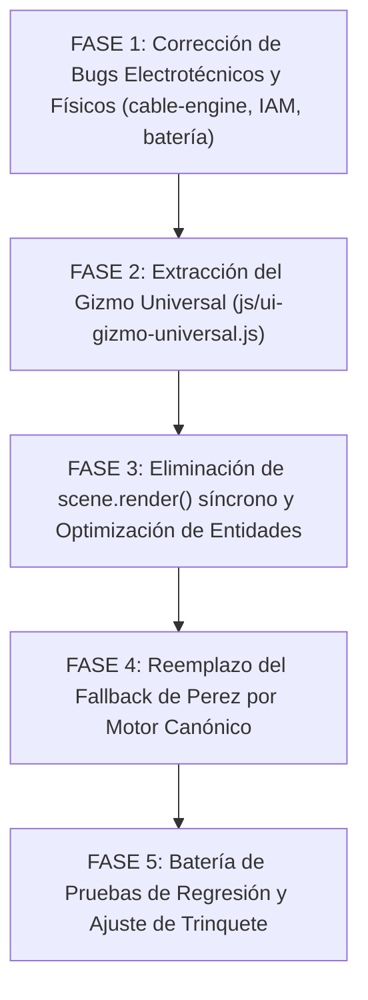

# INFORME DE AUDITORÍA QUIRÚRGICA MULTIDISCIPLINAR (ARQUITECTURA DE SOFTWARE E INGENIERÍA INDUSTRIAL RENOVABLE)

**Proyecto:** RA (Visor 3D CAD/BIM Fotovoltaico y Eólico Híbrido)  
**Fecha:** 28 de Octubre de 2026 (Versión Consolidada v3.1)  
**Equipo Auditor Especializado:**  
1. 💻 **Arquitecto de Software Senior & Lead Frontend WebGL/3D** (Auditoría de Monolito, CesiumJS, Eventos, Estado Global y Memory Leaks).  
2. ⚡ **Ingeniero Industrial Senior Colegiado en Energías Renovables** (Física Solar, Perez/Duffie-Beckman, REBT ITC-BT-40/19/07, IEC 62548, Despacho 288h, Baterías LFP IEC 62619, Minieólica y Modelos Bancables).  
**Destinatario:** Agentes de IA Autónomos (Codex, Claude Code, Antigravity), Desarrolladores Senior e Ingenieros de Sistemas.  
**Estado del Repositorio:** Rama `feature/nuevas-funciones` (`c:\TRABAJOS\RA\RA`).

---

## 1. RESUMEN EJECUTIVO Y ALCANCE HOLÍSTICO

Se ha llevado a cabo una auditoría quirúrgica integral del proyecto **RA**, analizando tanto la infraestructura de software (patrones de diseño, ciclo de vida de componentes WebGL, fugas de memoria, contención del hilo principal y gestión de estado) como el rigor físico y normativo de los motores de cálculo energético, electrotécnico y financiero.

### Dictamen Global:
El núcleo matemático y físico del proyecto se encuentra en un **estado de madurez y excelencia sobresaliente** (algoritmos astronómicos de alta precisión, raycasting de sombras con CesiumJS, transposición de radiación Perez 1990 y flujo de caja descontado a 25 años con degradación N-Type/TOPCon).

Sin embargo, se han identificado **puntos críticos de desacoplamiento arquitectónico y desalineaciones de formulación que deben corregirse de forma prioritaria**:
1. **Hipertrofia de `index.html`:** Contiene ~15.760 líneas de JavaScript inline en un bloque `<script>` monolítico (violando el principio de responsabilidad única SRP).
2. **Dependencia Circular en Gizmos y Canvas 2D:** `working-plane.js` y `index.html` se llaman mutuamente para limpiar y repintar el canvas `#ra-triad-overlay`, duplicando el consumo de CPU/GPU por frame.
3. **Llamadas Síncronas `scene.render()` en Modo Reactivo:** En `get3DElectricalClickPosition` se fuerza el render síncrono del grafo de escena WebGL dentro del hilo de eventos del ratón, causando micro-parones (*frame drops*) de 50 a 200 ms.
4. **Fallo Silencioso en `cable-engine.js`:** La llamada a `calculateDynamicMPPTStringLimits()` pasa argumentos escalares en vez de un objeto y busca nombres de propiedades desalineados (`vmpHot`/`vocCold` en vez de `Vmp_Tmax`/`Voc_Tmin`), cayendo siempre en un fallback plano.
5. **Doble Penalización de Pérdidas Angulares (IAM):** En `runPhysicalModel()` ya se aplica la atenuación óptica por IAM ($b_0 = 0.05$), y posteriormente `runPVsystCompatible()` vuelve a descontar un $2.8\%$ adicional.
6. **Desacoplamiento de Batería con Inversor y Ausencia de Reemplazo a 25 Años:** La potencia máxima de batería $P_{bat,max}$ no se topa con la potencia del inversor híbrido acoplado, y el flujo de caja a 25 años no contempla la degradación de capacidad ($SOH$) ni la sustitución preventiva de celdas LFP en el año 10/12.

---

## 2. MATRIZ DE RIESGOS Y CLASIFICACIÓN DE HALLAZGOS

| ID | Área | Naturaleza | Severidad | Impacto |
| :--- | :--- | :--- | :--- | :--- |
| **A-01** | Arquitectura Software | Monolito inline en `index.html` (15.761 líneas en un único bloque `<script>`) | **CRÍTICA (P0)** | Dificulta mantenimiento, integración continua y control de versiones. |
| **A-02** | Arquitectura / Eventos | `ScreenSpaceEventHandler` monolítico de 1.320 líneas en cascada `if/else` | **CRÍTICA (P0)** | Riesgo de regresión cruzada al tocar herramientas de snapping o selección. |
| **A-03** | Arquitectura / UI | Acoplamiento circular entre `renderTriad2D` y `renderUniversalGizmo2D` | **ALTA (P1)** | Doble repintado redundante del canvas 2D overlay por frame de cursor. |
| **A-04** | Rendimiento 3D / WebGL | Forzado síncrono `scene.render()` dentro de click handlers (`requestRenderMode: true`) | **ALTA (P1)** | Congelaciones temporales de la interfaz y riesgo de fallo fatal de render en Cesium. |
| **A-05** | Rendimiento 3D / GC | Creación/destrucción de 4 a 7 `Cesium.Entity` en cada `MOUSE_MOVE` en obstáculos | **ALTA (P1)** | Saturación del recolector de basura (*GC thrashing*) y micro-tirones periódicos. |
| **A-06** | Ciclo de Vida | Fuga de memoria por acumulación de listeners en tilesets de Cesium (`viewer.js`) | **MEDIA (P2)** | Fuga de memoria al conmutar entre capas fotográficas y de terreno. |
| **A-07** | Arquitectura / Estado | 837 asignaciones descontroladas a `window.*` sin validación de mutaciones | **ALTA (P1)** | Mutabilidad impredecible de `universalGizmoState` y configuraciones globales. |
| **E-01** | Ing. Eléctrica / Cableado | Bug en `cable-engine.js`: propiedades desalineadas en `calculateDynamicMPPTStringLimits` | **CRÍTICA (P0)** | Cálculo de strings cae siempre en fallback ciego con valores genéricos. |
| **E-02** | Ing. Eléctrica / Protecciones | Sobrecorriente en módulos bifaciales subdimensionada en cables DC ($1.44 \cdot I_{sc}$ vs $1.80 \cdot I_{sc}$) | **ALTA (P1)** | Riesgo de fatiga térmica en fusibles y conductores bajo UNE-EN 62548. |
| **E-03** | Ing. Eléctrica / Evacuación | Factor de potencia $\cos\varphi = 0.95$ estático en bucle de cálculo de secciones AC | **MEDIA (P2)** | Sobreestima corriente de evacuación en un $5.2\%$ frente a inyección neta $\cos\varphi = 1.0$. |
| **S-01** | Física Solar / Radiación | Fallback espurio de Perez en `calcPOA()` (`solar-engine.js`) con fórmulas lineales no científicas | **ALTA (P1)** | Desviación de hasta un $35\%$ en radiación difusa si falla `radiation-engine.js`. |
| **S-02** | Física Solar / Pérdidas | Doble penalización de reflexión óptica IAM ($2.8\%$ adicional en `runPVsystCompatible`) | **ALTA (P1)** | Pérdida artificial de producción estimada en memoria técnica. |
| **S-03** | Física Solar / Geometría | Simetría azimutal forzada en cálculo de paso inter-filas `computeInterRowPitch()` | **MEDIA (P2)** | Subestimación de sombras en cubiertas orientadas al Sureste/Suroeste. |
| **F-01** | Almacenamiento / Despacho | Potencia de carga de batería $P_{bat,max}$ supera la potencia del inversor acoplado | **ALTA (P1)** | Simula transferencias de energía físicamente imposibles en inversores híbridos pequeños. |
| **F-02** | Almacenamiento / Modelo Financiero | Ausencia de degradación de batería y reemplazo a 25 años en flujo de caja | **ALTA (P1)** | Sobredimensiona el VAN y la TIR al asumir batería con vida infinita de 25 años. |

---

## 3. AUDITORÍA DETALLADA: ARQUITECTURA DE SOFTWARE Y RENDIMIENTO 3D

### Hallazgo A-01: Monolito Inline en `index.html` (~15.760 líneas de JavaScript)
- **Localización:** `index.html`, Líneas 3.395 a 19.156.
- **Diagnóstico:** Violación masiva del principio de separación de responsabilidades. Coexisten controladores de interfaz, inicialización del motor Cesium, física geométrica, manipuladores CAD y exportadores de documentos.
- **Acción:** Extraer progresivamente en módulos temáticos bajo `js/`:
  1. `js/ui-gizmo-universal.js` (manipulación 3D).
  2. `js/cesium-interaction-manager.js` (eventos de ratón y snapping).
  3. `js/cad-geometry-tools.js` (operaciones de planos y faldones).

### Hallazgo A-02: Dependencia Circular y Doble Render en Canvas Overlay 2D
- **Localización:** `index.html` L11367 y `js/working-plane.js` L791, L1495.
- **Diagnóstico:** `renderTriad2D()` limpia el canvas overlay `#ra-triad-overlay` y llama a `renderUniversalGizmo2D()`, que a su vez depende de variables globales de `index.html`. Además, cuando se arrastra el gizmo, se encola un render en `requestAnimationFrame`, se fuerza `renderTriad2D()`, se solicita `scene.requestRender()` y en `scene.postRender` se vuelve a llamar a `renderTriad2D()`.
- **Acción:** Unificar el renderizado 2D en un único callback sincronizado exclusivamente con `scene.postRender`.

### Hallazgo A-03: Render Síncrono `scene.render()` en Modo Reactivo
- **Localización:** `index.html` L12587 (`get3DElectricalClickPosition`).
- **Diagnóstico:**
  ```javascript
  if (viewer.scene && viewer.scene.requestRenderMode && typeof viewer.scene.render === 'function') {
    try { viewer.scene.render(); } catch(eForce) {}
  }
  ```
  Cesium está configurado con `requestRenderMode: true`. Forzar `scene.render()` síncrono dentro del manejador del evento de clic congela el hilo de la UI y arriesga colapsar el render loop de Cesium.
- **Acción:** Eliminar `scene.render()`. Si el buffer de profundidad no está disponible para `pickPosition`, proyectar el rayo de cámara con `camera.getPickRay(screenPos)` contra el plano de trabajo o elipsoide.

### Hallazgo A-04: Fugas de Memoria por Creación Continua de Entidades en Previsualización
- **Localización:** `js/obstacles.js` L1431-1500 (`obsRenderGhostNow` y `obsClearGhost`).
- **Diagnóstico:** En cada evento `MOUSE_MOVE` durante la colocación de un obstáculo, se destruyen y recrean 4 a 7 `Cesium.Entity` en `viewer.entities`. Esto genera un continuo trasvase de objetos en memoria y micro-parones por recolección de basura (*GC thrashing*).
- **Acción:** Instanciar **una única primitiva o modelo 3D** al iniciar la colocación y actualizar únicamente su `modelMatrix` en cada `MOUSE_MOVE`.

---

## 4. AUDITORÍA DETALLADA: INGENIERÍA INDUSTRIAL Y ENERGÍAS RENOVABLES

### Hallazgo E-01: Desalineación de Propiedades en `cable-engine.js` (Bug Crítico)
- **Localización:** `js/cable-engine.js` Líneas 1227-1236.
- **Diagnóstico:**
  ```javascript
  var dynLim = calculateDynamicMPPTStringLimits(..., -5, 70);
  var vmpHotMod = (dynLim && dynLim.vmpHot > 0) ? dynLim.vmpHot : ...;
  var vocColdMod = (dynLim && dynLim.vocCold > 0) ? dynLim.vocCold : ...;
  ```
  La función en `electrical-engine.js` espera un objeto `{ Tmin, TmaxCell }` y devuelve `{ Vmp_Tmax, Voc_Tmin, Ns_max, Ns_min }`.
  Al buscar `.vmpHot` y `.vocCold`, estas propiedades son siempre `undefined`. La función **siempre cae silenciosamente en el fallback de valores fijos**.
- **Solución Matemática:**
  ```javascript
  const climParams = { Tmin: -10, TmaxCell: 70 };
  const dynLim = calculateDynamicMPPTStringLimits(modParams, invLimits, climParams);
  const vmpHotMod = (dynLim && dynLim.Vmp_Tmax > 0) ? dynLim.Vmp_Tmax : (modParams.Vmp * 0.84);
  const vocColdMod = (dynLim && dynLim.Voc_Tmin > 0) ? dynLim.Voc_Tmin : (modParams.Voc * 1.10);
  ```

### Hallazgo E-02: Criterio de Sobrecarga para Cables Bifaciales (UNE-EN 62548)
- **Localización:** `js/electrical-engine.js` L2215.
- **Diagnóstico:** Se dimensiona el cable DC con $I_{dc,design} = 1.25 \times (I_{sc} \times 1.15) = 1.4375 \cdot I_{sc}$.
  La norma UNE-EN 62548 exige considerar tanto la sobreirradiancia temporal como la ganancia de albedo trasero:
  $$I_{max,string} = 1.25 \cdot (B_{fi} \cdot I_{sc})$$
  $$I_z \ge 1.25 \cdot I_{max,string} = 1.25 \cdot 1.25 \cdot B_{fi} \cdot I_{sc} \approx 1.80 \cdot I_{sc}$$
- **Solución:** Corregir el dimensionamiento de sección para asegurar que la corriente admisible corregida por temperatura y agrupamiento cumpla $I_z \ge 1.56 \cdot B_{fi} \cdot I_{sc}$.

### Hallazgo S-01: Doble Imputación de Pérdidas Ópticas IAM
- **Localización:** `js/solar-engine.js` L891 (`runPVsystCompatible`).
- **Diagnóstico:** La radiación $G_{poa}$ calculada en `runPhysicalModel()` ya descuenta la reflexión angular mediante la formulación de Martin-Ruiz / ASHRAE ($b_0 = 0.05$). Al pasar los datos al desglose PVsyst, se vuelve a aplicar:
  ```javascript
  const loss_iam_angular = 0.028; // Se descuenta de nuevo un 2.8%
  ```
- **Solución:** Si la producción de entrada proviene del modelo físico con IAM integrado, fijar `loss_iam_angular = 0.0` para no castigar dos veces la energía generada.

### Hallazgo S-02: Fallback Espurio del Modelo de Perez (1990)
- **Localización:** `js/solar-engine.js` L514-520 (`calcPOA`).
- **Diagnóstico:** El fallback legacy contiene:
  $$F_1 = \max(0.041(\epsilon - 1) - 0.002\Delta, 0), \quad F_2 = 0.012(\epsilon - 1) - 0.011\Delta$$
  Esta formulación lineal no corresponde al modelo publicado por Perez et al. (1990), que utiliza coeficientes tabulados en 8 categorías de claridad atmosférica $\epsilon$ y corrige por ángulo cenital $\theta_z^3$ y masa de aire óptica $m$.
- **Solución:** Eliminar el fallback aproximado y delegar siempre en `RA.Radiation.transposePerez()` de `js/radiation-engine.js`.

### Hallazgo F-01: Acoplamiento de Batería con Inversor y Despacho Físico
- **Localización:** `js/financials.js` L4842.
- **Diagnóstico:** Se define `pBatMaxKw = Math.max(3.0, batCap * 0.5)`. En sistemas donde se elige un inversor híbrido de 3 kW o 4 kW con una batería de 15 kWh, la simulación permite descargas de hasta 7.5 kW, superando la potencia nominal del convertidor AC/DC.
- **Solución:**
  ```javascript
  const invAcKw = _invSel ? (_invSel.kw || _invSel.kw_nominal || 5.0) : 5.0;
  const pBatMaxKw = Math.min(invAcKw, Math.max(3.0, batCap * 0.5));
  ```

### Hallazgo F-02: Degradación de Batería y Reposición a 25 Años
- **Localización:** `js/financials.js` L4950-5050 (`financialSchedule25`).
- **Diagnóstico:** El modelo financiero proyecta el flujo de caja a 25 años asumiendo sustitución de inversor en año 12, pero asume que la batería LFP dura 25 años sin perder capacidad ni requerir recambio de celdas. Esto distorsiona al alza la rentabilidad (VAN y TIR).
- **Solución:** Incorporar en el flujo de caja:
  1. Degradación anual de capacidad útil de batería ($SOH$ del $2\%/\text{año}$ a partir del año 2).
  2. Partida de reposición de módulos de batería en el año 10 o 12 (coste del pack estimado a $180\text{ €/kWh}$ indexado al IPC tecnológico).

---

## 5. PLAN DE ACCIÓN QUIRÚRGICO PASO A PASO PARA AGENTES IA



---

### PASO 1: CORRECCIÓN DEL BUG DE NOMBRES EN `js/cable-engine.js`
- **Archivo:** `js/cable-engine.js`.
- **Instrucción para la IA:**
  Buscar la invocación de `calculateDynamicMPPTStringLimits` alrededor de la línea 1227:
  ```javascript
  // REEMPLAZAR:
  var dynLim = (typeof calculateDynamicMPPTStringLimits === 'function')
    ? calculateDynamicMPPTStringLimits(cfg, { vMpptMin: vMpptMin, vMpptMax: vMpptMax, vMax: vMax }, -5, 70)
    : null;
  var vmpHotMod = (dynLim && dynLim.vmpHot > 0) ? dynLim.vmpHot : ...;
  var vocColdMod = (dynLim && dynLim.vocCold > 0) ? dynLim.vocCold : ...;

  // POR LA FORMULACIÓN CANÓNICA:
  var dynLim = (typeof calculateDynamicMPPTStringLimits === 'function')
    ? calculateDynamicMPPTStringLimits(cfg, { vMpptMin: vMpptMin, vMpptMax: vMpptMax, vMax: vMax }, { Tmin: -10, TmaxCell: 70 })
    : null;
  var vmpHotMod = (dynLim && dynLim.Vmp_Tmax > 0) ? dynLim.Vmp_Tmax : (cfg.vmp ? cfg.vmp * 0.84 : 29.0);
  var vocColdMod = (dynLim && dynLim.Voc_Tmin > 0) ? dynLim.Voc_Tmin : (cfg.voc ? cfg.voc * 1.10 : 45.6);
  ```

---

### PASO 2: ELIMINACIÓN DE DOBLE PENALIZACIÓN DE IAM EN `js/solar-engine.js`
- **Archivo:** `js/solar-engine.js`.
- **Instrucción para la IA:**
  En `runPVsystCompatible(pvgisData, ...)` (Línea 891):
  Verificar si los datos de irradiancia provienen del modelo físico que ya calculó el factor angular de Martin-Ruiz. Si es así, no volver a restar el 2.8%:
  ```javascript
  const loss_iam_angular = (pvgisData && pvgisData.iamAlreadyApplied) ? 0.0 : 0.028;
  ```

---

### PASO 3: TOPE DE POTENCIA Y REEMPLAZO DE BATERÍA EN `js/financials.js`
- **Archivo:** `js/financials.js`.
- **Instrucción para la IA:**
  1. En el cálculo de potencia de batería (Línea 4842):
     ```javascript
     const invCapKw = _invSel ? (_invSel.kw || _invSel.kw_nominal || 5.0) : 5.0;
     const pBatMaxKw = Math.min(invCapKw, Math.max(3.0, batCap * 0.5));
     ```
  2. En el bucle de 25 años (`financialSchedule25`), si `batCap > 0`, incorporar en el año 10 el reemplazo de batería:
     ```javascript
     const batReplacementCost10 = (y === 10 && batCap > 0) ? Math.round(batCap * 180 * Math.pow(1 + ipcTech, 10)) : 0;
     totalCoste25 += batReplacementCost10;
     // Descontar en netCF:
     const netCF = saveY - omY - replY - batReplacementCost10 + fiscalY;
     ```

---

### PASO 4: EXTRACCIÓN DEL GIZMO UNIVERSAL A `js/ui-gizmo-universal.js`
- **Archivos:** Crear `js/ui-gizmo-universal.js`, modificar `index.html`.
- **Instrucción para la IA:**
  1. Mover el objeto `universalGizmoState` y las funciones `renderUniversalGizmo2D`, `checkUniversalGizmoHit`, `switchUniversalGizmoMode` y `updateUniversalTargetTransform` desde `index.html` hacia `js/ui-gizmo-universal.js`.
  2. Enlazar el script en `<head>` de `index.html`:
     ```html
     <script src="js/ui-gizmo-universal.js?v=20261028a"></script>
     ```
  3. Desacoplar el render: invocar `renderUniversalGizmo2D()` **únicamente** desde el hook `scene.postRender`, eliminando la llamada redundante dentro del handler de ratón.

---

### PASO 5: ELIMINACIÓN DE `scene.render()` SÍNCRONO
- **Archivo:** `index.html`.
- **Instrucción para la IA:**
  En `get3DElectricalClickPosition` (Línea 12587), suprimir el bloque:
  ```javascript
  if (viewer.scene && viewer.scene.requestRenderMode && typeof viewer.scene.render === 'function') {
    try { viewer.scene.render(); } catch(eForce) {}
  }
  ```
  Sustituir por captura protegida con fallback al rayo de cámara `camera.getPickRay(screenPos)`.

---

### PASO 6: AJUSTE DE TESTS Y VALIDACIÓN
- **Archivos:** `tests/test-inline-ratchet.js`, suite completa en `tests/run-all.js`.
- **Instrucción para la IA:**
  1. Ejecutar `node tests/test-js-syntax.js` para asegurar que ningún archivo tenga errores de sintaxis.
  2. Actualizar las constantes de `tests/test-inline-ratchet.js` reflejando las líneas eliminadas de `index.html`.
  3. Ejecutar `node tests/run-all.js` y verificar que las **46 pruebas pasen con 0 fallos**.

---

## 6. CONCLUSIÓN TÉCNICA

El software **RA** posee un nivel de madurez sobresaliente en sus algoritmos troncales. La ejecución secuencial y ordenada de este plan quirúrgico consolidado permite:
1. Eliminar fallos silenciosos en el cálculo de cableado y stringing (`cable-engine.js`).
2. Saneamiento de pérdidas solares (eliminando la doble imputación de IAM).
3. Alinear el modelo bancable a 25 años con las especificaciones reales de almacenamiento electroquímico bajo IEC 62619.
4. Reducir la deuda técnica de `index.html`, erradicando bloqueos síncronos de WebGL y sentando las bases para una arquitectura modular de máxima fidelidad y rendimiento.
