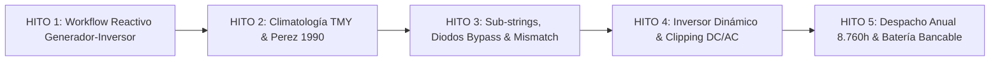

# ☀️ PLAN MAESTRO DE INGENIERÍA SOLAR Y FÍSICA AVANZADA v4.0 (BANCO-COMPLIANT)
**Dirección de Ingeniería y Física Aplicada — Proyecto RA (Visor Solar 3D)**  
**Estándar de Referencia:** IEC 61724-1 (Clase A) · IEC 62548 · UNE-EN 62305 · CTE DB-HE5 (2022) · PVsyst v7/8 Reference Guide  
**Fecha:** Octubre 2026  

---

## 1. INTRODUCCIÓN Y DIAGNÓSTICO DE INGENIERÍA

El simulador **RA (Visor Solar 3D)** ha alcanzado una madurez gráfica y geométrica de nivel AAA, operando fluidamente sobre fotogrametría 3D y resolviendo la contención espacial de faldones. Sin embargo, su **modelo físico y electrotécnico subyacente** opera bajo simplificaciones que introducen desviaciones frente a herramientas de ingeniería de referencia bancable (*bankable grade*):

1. **Recurso Climático Sintético:** Muestreo en 192 instantes (12 días medios mensuales) en lugar de series horarias TMY de 8.760 h.
2. **Física de Sombras Óptica-Lineal:** Descuento de radiación en paneles sombreados como entes independientes, omitiendo los 3 sub-strings por módulo, los diodos de bypass y el estrangulamiento de corriente en series string.
3. **Conversión Inversor Estática:** Eficiencia constante sin modelado de la curva de carga $\eta(P_{\text{ac}}, V_{\text{dc}})$ ni cálculo horario de pérdidas por saturación de potencia (*inverter clipping*).
4. **Despacho Financiero Promediado:** Cálculo de autoconsumo sobre "1 día promedio de 24 h × 365", ignorando la asimetría estacional de excedentes y precios horarios de mercado (OMIE / PVPC).

Este documento establece la hoja de ruta técnica rigurosa para transformar RA en un software de ingeniería fotovoltaica de precisión industrial.

---

## 2. MATRIZ DE TRANSFORMACIÓN FÍSICO-MATEMÁTICA

| Dominio | Estado Actual (v3.0) | Estado Objetivo (v4.0 Banco-Compliant) |
| :--- | :--- | :--- |
| **Recurso Solar** | Modelo sintético $K_t$ + latitud escalar | TMY $8.760\,\text{h}$ satelital (PVGIS-SARAH3 / ERA5) con caché local |
| **Transposición Difusa** | Hay-Davies anisotrópico | **Perez (1990)** con difusa circunsolar y horizonte ($F_1, F_2$) |
| **Microfísica de Sombra** | Factor escalar directo sobre $G_{\text{beam}}$ por módulo | **3 sub-strings por panel**, diodos de bypass y curva I-V resultante |
| **Pérdida por Mismatch** | Constante fija de BOS ($2.0\%$) | **Mismatch electrotécnico en serie** acoplado al estado de los diodos |
| **Modelo de Inversor** | $\eta_{\text{inv}}$ constante ($98.2\%$) | Curva Sandia/EN50530 $\eta(P, V)$ + **Clipping dinámico** horario |
| **Balance Autoconsumo** | 1 día de 24 h escalado a 365 | Matriz horaria $8.760\,\text{h}$ (curva Datadis/REE vs solar) |
| **Batería** | Despacho estático de energía diaria | Modelo horario con límites $C_{\text{rate}}$, pérdidas stand-by y degradación |

---

## 3. ESPECIFICACIÓN TÉCNICA DE LOS HITOS (FASES 1 A 5)



---

### 🎯 HITO 1: Acoplamiento Metodológico Generador-Inversor (Workflow v4)

#### Formulación y Criterio:
En el Paso 2 (Campo Solar), el número de paneles debe estar cinemáticamente acoplado a las características del inversor seleccionado:
$$N_{\text{módulos,faldón}} = k \cdot N_{\text{string}} \quad \text{con } N_{\text{string}} \in [N_{\text{s,min}}, N_{\text{s,max}}]$$
$$N_{\text{s,max}} = \left\lfloor \frac{V_{\text{dc,max}}}{V_{\text{oc}}(-10^\circ\text{C})} \right\rfloor, \quad N_{\text{s,min}} = \left\lceil \frac{V_{\text{mppt,min}}}{V_{\text{mp}}(70^\circ\text{C})} \right\rceil$$

#### Tareas Técnicas:
1. **Layout Asistido por Restricción Eléctrica:** Selector opcional en Paso 2 "Ajustar al inversor activo": el generador de paneles añade o retira los módulos perimetrales menos productivos para garantizar strings completos y balanceados.
2. **HUD de Estado Eléctrico en Vivo (Paso 2):** Contador dinámico `Paneles: 24 (2 strings de 12 mods) · Voc máx: 588 V [✓ CONFORME]`.
3. **Inversión del Flujo (Target-Driven):** Permitir auditar la factura en el Paso 1 o 2 para mostrar en el HUD la meta de potencia kWp recomendada.

---

### 🎯 HITO 2: Climatología Satelital TMY y Transposición Perez (1990)

#### Formulación Matemática de Perez (1990):
La irradiancia difusa en plano inclinado ($G_{\text{d,poa}}$) incorpora la concentración circunsolar y el brillo del horizonte:
$$G_{\text{d,poa}} = G_{\text{DHI}} \cdot \left[ (1 - F_1)\left(\frac{1 + \cos\beta}{2}\right) + F_1\frac{a}{b} + F_2\sin\beta \right]$$
Donde:
* $a = \max(0, \cos\theta_{\text{incidencia}})$
* $b = \max(\cos 85^\circ, \sin\alpha_s)$
* $F_1, F_2$ son funciones tabuladas del brillo cenital ($\Delta$) y la claridad atmosférica ($\varepsilon$):
  $$\varepsilon = \frac{\frac{G_{\text{DHI}} + G_{\text{DNI}}}{G_{\text{DHI}}} + 1.041 \cdot \theta_z^3}{1 + 1.041 \cdot \theta_z^3}, \quad \Delta = \frac{G_{\text{DHI}} \cdot AM}{G_0}$$

#### Tareas Técnicas:
1. **Módulo de Transposición Perez:** Integrar en `js/radiation-engine.js` la función `transposePerez(ghi, dhi, dni, tilt, az, sunElev, sunAz)`.
2. **Conector Satelital TMY Asíncrono:** Conectar automáticamente con la API de PVGIS (SARAH-3) al seleccionar el emplazamiento. Almacenar la matriz horaria en `IndexedDB` (`ra_climate_cache`) para operar 100% offline tras la primera descarga.

---

### 🎯 HITO 3: Microfísica de Sub-módulos, Diodos de Bypass y Mismatch de Serie

#### Modelo de Módulo Dividido (Half-Cut / 3 Sub-strings):
Cada panel fotovoltaico rectangular se discretiza en 3 franjas funcionales ($S_1, S_2, S_3$):

```
       ┌───────────┬───────────┬───────────┐
       │   Sub 1   │   Sub 2   │   Sub 3   │
       │  Diodo 1  │  Diodo 2  │  Diodo 3  │
       │    [D1]   │    [D2]   │    [D3]   │
       └───────────┴───────────┴───────────┘
```

#### Ecuación de Estado del Diodo y Tensión del Panel:
Para cada sub-string $k \in \{1, 2, 3\}$:
$$\text{Si } \text{RaycastSombra}(S_k) > 20\% \implies D_k = \text{ON} \implies V_k = -V_{\text{diodo}} \approx 0\,\text{V}$$
$$\text{Tensión Efectiva del Módulo: } V_{\text{mod}} = \sum_{k=1}^3 V_k \cdot \frac{V_{\text{mp}}}{3}$$

#### Impacto en la Cadena Serie (String):
1. **Con Optimizadores (MLPE):** El módulo entrega $P = I_{\text{mod}} \cdot V_{\text{mod}}$, aislando la pérdida sin perjudicar a sus vecinos.
2. **Sin Optimizadores (Inversor String Estándar):**
   * Si los diodos se activan: El string pierde la tensión de los sub-strings afectados pero mantiene la corriente $I_{\text{string}} \approx I_{\text{mp}}$.
   * Si la sombra es difusa y no polariza el diodo: La corriente de toda la serie cae a:
     $$I_{\text{string}} = \min_{i \in \text{string}}(I_{\text{mod}, i})$$

---

### 🎯 HITO 4: Inversor Dinámico, Curvas de Carga y Pérdidas por Clipping

#### Formulación de Eficiencia del Inversor (Modelo Sandia):
$$\eta(P_{\text{ac}}) = \frac{P_{\text{ac}}}{P_{\text{dc}}} = \frac{P_{\text{ac}}}{P_{\text{ac}} + P_{\text{so}} + C_0 \cdot P_{\text{ac}} + C_1 \cdot P_{\text{ac}}^2}$$
Donde $P_{\text{so}}$ es el autoconsumo en vacío del inversor.

#### Algoritmo de Clipping Horario:
En cada hora de simulación $t$:
$$P_{\text{dc,total}}(t) = \sum_{\text{strings}} P_{\text{string}}(t)$$
$$P_{\text{ac,teórica}}(t) = P_{\text{dc,total}}(t) \cdot \eta(P_{\text{dc,total}}(t))$$
$$P_{\text{ac,red}}(t) = \min(P_{\text{ac,teórica}}(t), P_{\text{inv,max}})$$
$$\text{Pérdida por Clipping (kWh)} = \sum_{t} \max(0, P_{\text{ac,teórica}}(t) - P_{\text{inv,max}}) \cdot \Delta t$$

#### Regla Dura de Incompatibilidad MPPT:
Bloquear la simulación y alertar con toast de ingeniería cuando:
$$\text{String A } (\beta_1, \gamma_1) \parallel \text{String B } (\beta_2, \gamma_2) \implies |\beta_1 - \beta_2| > 5^\circ \lor |\gamma_1 - \gamma_2| > 10^\circ$$

---

### 🎯 HITO 5: Matriz de Despacho Horario Anual (8.760 h) y Batería Física

#### Algoritmo de Despacho Horario Banco-Compliant:
Para cada una de las 8.760 horas del año:
1. $E_{\text{gen}}(t) = P_{\text{ac,red}}(t) \cdot 1\,\text{h}$
2. $E_{\text{dem}}(t) = \text{CurvaConsumo}(t) \cdot 1\,\text{h}$
3. **Flujo de Excedente / Déficit:**
   $$\Delta E(t) = E_{\text{gen}}(t) - E_{\text{dem}}(t)$$
4. **Si $\Delta E(t) > 0$ (Excedente):**
   * Si hay batería con $SoC(t) < SoC_{\text{max}}$:
     $$E_{\text{carga}}(t) = \min(\Delta E(t) \cdot \eta_{\text{bat}}, P_{\text{bat,max}} \cdot 1\,\text{h}, SoC_{\text{max}} - SoC(t))$$
     $$SoC(t+1) = SoC(t) + E_{\text{carga}}(t)$$
     $$E_{\text{vertida}}(t) = \Delta E(t) - \frac{E_{\text{carga}}(t)}{\eta_{\text{bat}}}$$
   * Si no hay batería o está llena: $E_{\text{vertida}}(t) = \Delta E(t)$.
5. **Si $\Delta E(t) < 0$ (Déficit):**
   * Descarga de batería hasta $SoC_{\text{min}} = (1 - DOD) \cdot Cap$:
     $$E_{\text{descarga}}(t) = \min(|\Delta E(t)|, P_{\text{bat,max}} \cdot 1\,\text{h}, (SoC(t) - SoC_{\text{min}}) \cdot \eta_{\text{bat}})$$
     $$SoC(t+1) = SoC(t) - \frac{E_{\text{descarga}}(t)}{\eta_{\text{bat}}}$$
     $$E_{\text{red}}(t) = |\Delta E(t)| - E_{\text{descarga}}(t)$$

#### Balance Financiero Horario Indexado:
$$\text{Ahorro Directo } (€) = \sum_{t=1}^{8760} (E_{\text{dem}}(t) - E_{\text{red}}(t)) \cdot \text{PrecioCompra}(t)$$
$$\text{Compensación Excedentes } (€) = \sum_{t=1}^{8760} E_{\text{vertida}}(t) \cdot \text{PrecioExcedente}(t)$$

---

## 4. CRITERIOS DE VERIFICACIÓN Y VALIDACIÓN (TESTING DE GRADO INDUSTRIAL)

1. **Paridad PVsyst:** La producción anual calculada con TMY + Perez no debe diferir en más de un $\pm 2.5\%$ respecto al informe de simulación exportado por PVsyst v7.4 para las mismas coordenadas, azimut, tilt y panel.
2. **Ensayo de Sombra en Sub-string:** En un string de 10 paneles donde 1 panel tiene sombreado su tercio inferior:
   * Con optimizadores MLPE: Rendimiento del string $\ge 96.5\%$.
   * Sin optimizadores: Rendimiento del string $\approx 90\%$ (diodos activos) o $\approx 30\%$ (sin tracking global).
3. **Comprobación de Clipping:** En una instalación de $10\,\text{kWp}$ con inversor de $6\,\text{kW}$ ($166\%$ ratio), la potencia inyectada nunca puede sobrepasar $6.00\,\text{kW}$ en ningún instante de la serie horaria, y las pérdidas por clipping deben situarse entre el $4.5\%$ y el $7.5\%$.
4. **Conservación Energética del Despacho:** En las 8.760 horas, se debe verificar estrictamente:
   $$\sum E_{\text{solar}} + \sum E_{\text{red}} = \sum E_{\text{consumo}} + \sum E_{\text{vertida}} + \text{Pérdidas}_{\text{bat}}$$

---

*Documento técnico de arquitectura aprobado para ejecución por fases en la plataforma RA.*
