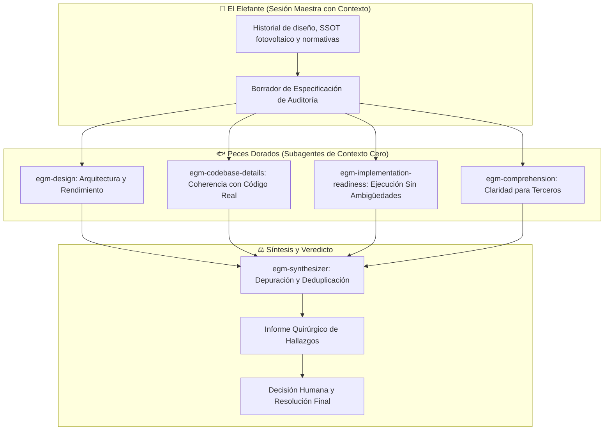

# Protocolo Quirúrgico de Auditoría Técnica para RA con Elephant-Goldfish Model (EGM)

Este documento detalla el procedimiento de ejecución paso a paso para someter el núcleo de cálculo, maquetación y arquitectura de **RA** a una auditoría rigurosa y sin sesgos de memoria previa.

---

## 1. Arquitectura de la Auditoría (Elefante vs. Peces Dorados)



---

## 2. Caso Práctico Real: Auditoría del Módulo Financiero y CEL

Imagina que deseamos auditar a fondo:
1. La sincronización del modelo financiero acumulado con el retorno real de la inversión.
2. La consistencia entre el radar de cobertura de cinco kilómetros y el marco del Real Decreto-ley 7/2026.
3. El cálculo de reposición de inversores y acumuladores en los años diez y doce.

---

## 3. Las Cuatro Fases de Ejecución

### Fase 1: Delimitación del Alcance (El Elefante)
En esta fase, la sesión maestra vuelca el contexto sin escribir código nuevo.
* **Comando:** `/egm-draft`
* **Instrucción de ejemplo:**
  > *"Redacta una especificación de auditoría técnica exhaustiva que contraste el flujo dinámico de caja de veinticinco años, el cálculo de excedentes horarios con coeficientes dinámicos y la prevención de sobrecostes por duplicidad fiscal."*

### Fase 2: El Asalto del Enjambre (Los Peces Dorados)
Se lanzan los revisores independientes. Cada uno recibe solo el documento generado, sin acceso al historial de conversación.
* **Comando:** `/egm-review` (o `/egm-review-loop` si se busca convergencia iterativa hasta cero defectos).
* **Roles activos en el ataque:**
  * **Crítico de Diseño:** Revisa si el consumo de memoria en simulaciones con muchos paneles o turbinas degrada el hilo principal del visor.
  * **Auditor de Código:** Abre los módulos reales en segundo plano y certifica si las fórmulas del documento coinciden al milímetro con lo que hace el software.
  * **Auditor de Preparación:** Exige que no haya huecos del tipo *"ajustar según criterio del instalador"*.

### Fase 3: Síntesis de Discrepancias
El agregador unifica los hallazgos en una matriz de tres categorías:
* **Bloqueantes (P0):** Errores de cálculo o discrepancias con normativas eléctricas vigentes.
* **Mejoras Arquitectónicas (P1):** Fugas de rendimiento o dependencias cruzadas entre el motor de cálculo y el visor tridimensional.
* **Refinamientos Visuales (P2):** Solapes tipográficos o escalas de gráficos poco intuitivas.

### Fase 4: Resolución Aprobada (Cierre)
* **Comando:** `/egm-resolve`
* **Acción:** Tú decides qué observaciones se admiten y cuáles se descartan; las aprobadas se corrigen de una sola vez en el código fuente.

---

## 4. Instrucción Rápida para Arrancar Esta Auditoría

Para iniciar este proceso sobre cualquier parte del proyecto, basta con indicar:

```text
/egm-draft Auditar la coherencia entre el cálculo financiero de amortización, las métricas del catálogo SSOT y la representación gráfica en la propuesta comercial
```
